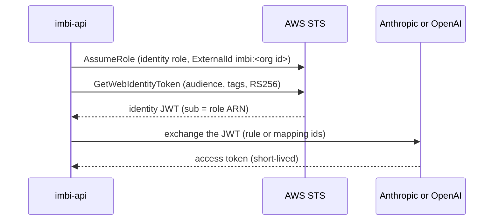

# Workload Identity Runbook

This runbook sets up workload identity federation (WIF) from the start to
the end: AWS, the Anthropic Console, the OpenAI dashboard, and Imbi. After
the setup, Imbi stores no Anthropic or OpenAI API key. Each agent and each
AI Provider gets a short-lived vendor token.

This page gives the order and the values for each side. The Imbi screens
have their own pages, linked from each step.

## How a token is made



The JWT `sub` is the role ARN. Its request tags are `imbi_org` (the Imbi
organization id) and one of `imbi_agent` (an agent id) or
`imbi_ai_provider` (an AI Provider id). Each JWT is used one time. Imbi
never logs the JWT or the token.

| Vendor | Audience | JWT lifetime | Token lifetime |
|---|---|---|---|
| Anthropic | `https://api.anthropic.com` | 300 seconds | The rule's `token_lifetime_seconds`, at most 600 seconds (twice the JWT) |
| OpenAI | `https://api.openai.com/v1` | 3600 seconds | At most 1 hour, never longer than the JWT |

Imbi sets the audience, the tags, the lifetime, and the signing algorithm
(`RS256`). No setting can change them.

## Before you start

Open **Admin, Secrets, Identity**. The **Vendor setup** section shows
the values that the other steps need, each with a copy button:

- The organization id, and the ExternalId `imbi:<organization id>` for
  the trust policy of the role.
- The id of each agent of the organization, and of each Anthropic and
  OpenAI AI Provider.
- After step 2: for each agent and AI Provider, the ready Anthropic rule
  condition or OpenAI mapping claims (steps 3 and 4).

Use a separate setup for each Imbi organization: one identity role, and
rules or mappings that match that organization's id.

## Step 1: AWS

### Turn on outbound web identity federation

In the AWS account of the identity role, open IAM, **Account settings**,
and turn on **Outbound web identity federation**. Copy the issuer URL
(`https://<id>.tokens.sts.global.api.aws`). The vendors need it.

The setting is for the whole account. Other roles in the account can then
call `GetWebIdentityToken` if their policies allow it, but they cannot
make a JWT with the `sub` of the Imbi role.

### imbi-api identity

The imbi-api pods need an AWS identity that can call `sts:AssumeRole` on
the identity role, as for the Secrets Manager role (see
[Secrets, imbi-api identity](secrets.md#imbi-api-identity)).

### The identity role

Create a new role. Do not use the Secrets Manager role. Use the same
trust policy as the Secrets Manager role, with the `sts:ExternalId`
condition (see [Secrets, The role](secrets.md#the-role)).

Only imbi-api must be able to assume this role. Any principal that can
assume it can set any `imbi_agent` tag, and so can act as any agent of the
organization.

Permission policy. Replace the organization id:

```json
{
  "Version": "2012-10-17",
  "Statement": [
    {
      "Effect": "Allow",
      "Action": "sts:GetWebIdentityToken",
      "Resource": "*",
      "Condition": {
        "ForAllValues:StringEquals": {
          "sts:IdentityTokenAudience": [
            "https://api.anthropic.com",
            "https://api.openai.com/v1"
          ],
          "aws:TagKeys": ["imbi_org", "imbi_agent", "imbi_ai_provider"]
        },
        "StringEquals": {
          "aws:RequestTag/imbi_org": "<organization id>",
          "sts:SigningAlgorithm": "RS256"
        },
        "NumericLessThanEquals": {"sts:DurationSeconds": "3600"}
      }
    },
    {
      "Effect": "Allow",
      "Action": "sts:TagGetWebIdentityToken",
      "Resource": "*",
      "Condition": {
        "ForAllValues:StringEquals": {
          "aws:TagKeys": ["imbi_org", "imbi_agent", "imbi_ai_provider"]
        },
        "StringEquals": {"aws:RequestTag/imbi_org": "<organization id>"}
      }
    }
  ]
}
```

- `sts:TagGetWebIdentityToken` is necessary because Imbi sends tags. It
  supports only the tag conditions, so it has its own statement.
- The `aws:RequestTag/imbi_org` condition makes the tag necessary, and
  stops the role from minting a JWT for a different organization.
- `aws:TagKeys` refuses all other tag keys.
- Remove the audience of a vendor that you do not use.

For OpenAI, set the role's **Maximum session duration** to 2 hours. The
OpenAI JWT lasts 1 hour, and the role session must last longer.

!!! warning "OpenAI and role chaining"
    When imbi-api has role credentials (IRSA, EKS Pod Identity, or another
    assumed role), the AssumeRole call is role chaining, and AWS limits the
    session to 1 hour. The 3900-second session for OpenAI then fails with
    `invalid_request`. Anthropic is not affected. See
    [issue #583](https://github.com/AWeber-Imbi/imbi/issues/583).

## Step 2: the Imbi identity source

In **Admin, Secrets, Identity**, set the identity source to **AWS STS**
with the region and the identity role ARN. See
[Secrets, Workload identity](secrets.md#workload-identity), step 1. If the
save fails, the error message shows the exact `imbi:<organization id>`
for the trust policy.

## Step 3: Anthropic Console

The field names below are the names in the Anthropic API reference. The
Console labels can be different.

1. Register the issuer URL from step 1 as an identity provider, in
   discovery mode. Anthropic reads the AWS signing keys from the issuer.
2. For each agent, and for each Anthropic AI Provider, create:
   1. A service account. Anthropic tracks usage and cost for each service
      account.
   2. A federation rule for that service account:

| Field | Value |
|---|---|
| `subject_prefix` | The identity role ARN |
| `audience` | `https://api.anthropic.com` |
| `condition` (CEL) | See below |
| `oauth_scope` | `workspace:inference` |
| `token_lifetime_seconds` | `600` |
| Workspaces | The workspace of the agent or provider |

`subject_prefix` is a prefix match: `role/imbi` also matches
`role/imbi-other`. So the condition also checks `sub` exactly, and checks
the tag of one agent. Copy the condition from **Vendor setup** (see
[Before you start](#before-you-start)). It has this form:

```text
claims.sub == "arn:aws:iam::123456789012:role/imbi-identity" &&
claims["https://sts.amazonaws.com/"].request_tags.imbi_org == "<organization id>" &&
claims["https://sts.amazonaws.com/"].request_tags.imbi_agent == "<agent id>"
```

For an AI Provider, use `imbi_ai_provider == "<AI Provider id>"` instead
of `imbi_agent`. Do not use wildcards: one rule matches one agent or one
provider.

Write down the ids of each rule: `organization_id`, `federation_rule_id`,
`service_account_id`, and `workspace_id` (necessary only when the rule has
more than one workspace).

Imbi cannot revoke an Anthropic token. A short `token_lifetime_seconds`
limits the time that a leaked token works.

## Step 4: OpenAI dashboard

Do this step only for OpenAI AI Providers. Agents call only the Anthropic
API.

1. Create a workload identity provider:
   - Issuer: the issuer URL from step 1.
   - Audience: `https://api.openai.com/v1`.
   - AWS request tags are nested in the JWT, and mappings match only
     scalar claims. Add a CEL transformation for each tag that a mapping
     uses. Use these attribute names and expressions:

     | Attribute name | CEL expression |
     |---|---|
     | `imbi_org` | `assertion["https://sts.amazonaws.com/"]["request_tags"]["imbi_org"]` |
     | `imbi_ai_provider` | `assertion["https://sts.amazonaws.com/"]["request_tags"]["imbi_ai_provider"]` |

     OpenAI stores each attribute with the `openai.` prefix, for example
     `openai.imbi_org`.

2. For each OpenAI AI Provider, create a service account and a mapping.
   The mapping matches `sub` to the identity role ARN exactly,
   `openai.imbi_org` to the organization id, and `openai.imbi_ai_provider`
   to the AI Provider id. In **Vendor setup**, the copy button for each
   provider copies the three claims as `key = value` lines. The OpenAI
   dashboard has separate Key and Value fields, so add one mapping row
   for each line.

Write down `identity_provider_id` and `service_account_id`.

An identity provider takes at most 50 mappings. An organization takes at
most 50 identity providers.

## Step 5: Imbi

- For each agent: add an **Anthropic workload identity** provider (one for
  the organization), a `dynamic` binding with the rule ids, a
  `model_inference` grant with delivery `file_descriptor`, and set the
  binding as the agent's **Model key**. See
  [Secrets, Workload identity](secrets.md#workload-identity), steps 2 to 4.
- For each AI Provider: select the organization and enter the target ids.
  See
  [AI Models](ai-models.md#use-workload-identity-instead-of-a-key).
- For imbi-api, the assistant, and the Slack bot: set the
  `IMBI_AI_PROVIDER_*` variables and the service account API keys. See
  [AI Models, Imbi services](ai-models.md#imbi-services).

## Step 6: check

1. AI Provider: click the refresh icon on the provider row (see
   [Discover and import models](ai-models.md#discover-and-import-models)).
   The model list comes back only after a full token exchange. A failure
   shows `No workload identity token: <reason>`.
2. Agent: run a short task with the agent. Then open **Admin, Secrets,
   Audit**. A failed mint shows the reason on the denied request.
3. Run a task that is longer than two token lifetimes (more than 20
   minutes for Anthropic), and run two tasks at the same time. The runner
   renews the token during the task.

## Troubleshooting

The Imbi reason tells you where the problem is.

| Reason | Cause | Fix |
|---|---|---|
| `federation_disabled` | Outbound web identity federation is off | Turn it on (step 1) |
| `access_denied` | The trust policy or the permission policy refuses the call | Check the principal, the ExternalId, and the policy conditions (step 1) |
| `invalid_request` | AWS refused a parameter, for example a role session longer than the role's maximum session duration, or longer than 1 hour with role chaining | Raise the maximum session duration, and see the warning in step 1 |
| `credentials_expired` | The imbi-api AWS credentials expired | Check the imbi-api identity (IRSA or Pod Identity) |
| `throttled`, `unreachable`, `unavailable` | AWS or the vendor did not answer | Imbi tries again on the next request |
| `exchange_refused` | The vendor refused the JWT | See below |
| `workload_identity_not_configured` | The organization has no identity source | Do step 2 |
| `invalid_target` | The binding locator or the AI Provider target is not valid | Enter the ids again (steps 3 to 5) |
| `agent_not_in_organization` | The agent is not in the organization of the binding | Use a binding of the agent's organization |

The vendors give the same answer for every refused exchange. The cause is
only in the vendor console: the Anthropic Console authentication history,
or the OpenAI dashboard. Check these first:

- The issuer URL is the one from step 1.
- The audience is the one in the table at the top of this page.
- `sub` is the identity role ARN, exactly.
- The tag values are the ids of this organization and this agent or
  provider.
- The ids in Imbi are the ids of this rule or mapping.

## Rollout and rollback

1. Do steps 1 to 6 for one agent or one AI Provider.
2. Watch the Audit tab and the vendor console for one day: exchange
   failures, and model `401` and `403` responses.
3. Move the other agents and providers.
4. Keep the old API key binding or key for one week, but do not use it.
   Then delete it, and revoke the key in the vendor console.

To roll back an agent, set its **Model key** to the old binding. To roll
back an AI Provider, click **Stop using workload identity** and set a key.
To stop all minting for an organization, remove its identity source.

## Monitoring

- CloudTrail logs each `GetWebIdentityToken` call with its tags.
- Alert on changes to the identity role's trust policy and permission
  policy, and on `AssumeRole` calls from principals other than imbi-api.
