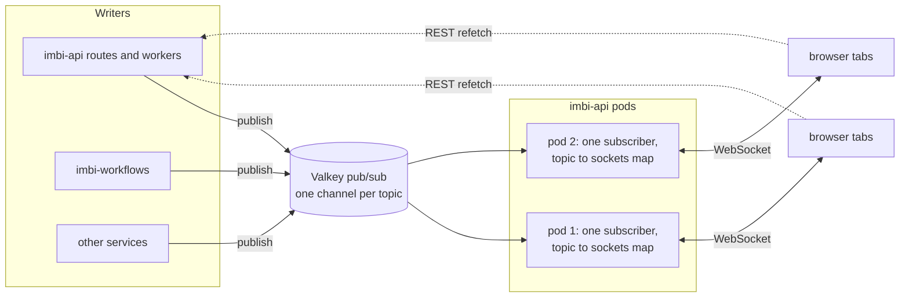

# ADR 0023: Realtime Channel Between the UI and the Services

Date: 2026-10-23

## Status

Proposed

Related: [ADR 0002](0002-authentication-and-authorization-architecture.md)
(authentication), [ADR 0019](0019-apache-iggy-message-streaming.md)
(Iggy), [ADR 0020](0020-agent-task-contract.md) (agent tasks),
[ADR 0021](0021-workflow-contract.md) (workflows).

## Context

The UI learns about a change only when it asks. A change made by another
person, an agent, a webhook, or a background job reaches an open page
only when that page refetches.

A direct deploy shows the problem. The person who clicks Deploy sees a
toast that `DeploymentRunWatcher` keeps up to date by polling the run
from that one browser. Everyone else on the project sees nothing. Their
`currentReleases` query uses the global defaults in
`ui/src/lib/queryClient.ts`: a `staleTime` of five minutes and no
refetch on window focus. Until
[#534](https://github.com/AWeber-Imbi/imbi/pull/534), a deploy of a
commit with no Release was not recorded at all, so a reload did not
show it either.

Features that must be live each built their own polling loop:

| File | Interval | Watches |
|---|---|---|
| `components/deploy/DeploymentRunWatcher.tsx` | 4 s | A direct deploy, rollback, or inline promote, in the browser that started it |
| `components/deploy/ReleaseBuildWatcher.tsx` | 6 s | A release build |
| `components/releases/releaseInFlight.tsx` | 6 s | A promote |
| `components/agents/taskQueries.ts` | 3 s, 15 s | Task events, the inbox, the "waiting on you" count |
| `components/workflows/workflowQueries.ts` | 2 s | Open workflow runs |
| `hooks/useCommitSync.ts`, `usePRSync.ts`, `useDeploymentResync.ts`, `useMaintenanceOperations.ts` | 3 s | Background syncs and maintenance operations |
| `hooks/useDocumentPresence.ts` | 10 s | The "currently editing" heartbeat for documents |
| `components/admin/AgentRunners.tsx` | 15 s | Runner status |

These facts shape the decision:

1. **REST and TanStack Query are the read model.** Every page reads
   through REST endpoints that check permissions, and
   `ui/src/lib/queryKeys.ts` names the query keys in one place.
2. **Writes happen in more than one process.** imbi-api does most of
   them, and the agent task store, comments, and deployments are there.
   imbi-workflows writes run state, and other services write the graph
   directly. Only imbi-api connects to Valkey today.
3. **Valkey is required in practice.** With `VALKEY_URL` unset, imbi-api
   falls back to `valkey://localhost:6379/0`. Its workers start and then
   fail on their first command.
4. **imbi-api can run more than one pod.** `service.api.replicas` in the
   Helm chart sets the count. The Deployment uses the default rolling
   update, so even at one replica an old pod and a new pod both serve
   traffic during a rollout.
5. **A browser WebSocket cannot set an `Authorization` header.** imbi-api
   already mirrors the access token into the `imbi_access_token` cookie
   for `` requests. The cookie is `HttpOnly` and `SameSite=Strict`,
   its path is the API prefix, and it lives as long as the access token
   (one hour by default).
6. **The stack supports WebSockets now.** `uvicorn[standard]` installs
   `websockets`, and Caddy proxies upgrade requests on `/api/*` with no
   extra configuration.
7. **Some state belongs to other systems.** GitHub owns the status of a
   workflow run. Promote builds have a server-side watch job
   (`release_promote/queue.py`). Direct deploys, rollbacks, and inline
   promotes do not. Their status is recorded by a GitHub webhook, by a
   manual resync, or as a side effect of any page load:
   `list_current_releases` asks GitHub about every in-flight run it
   returns (`_reconcile_in_flight_run` in `releases.py`).

## Decision

### One WebSocket per browser tab

The UI opens one WebSocket to imbi-api per tab. All features share it.

A WebSocket carries messages in both directions on one connection.
Presence updates go from the browser to the server as often as events go
the other way. Server-Sent Events (SSE) would need a second channel for
those. See [Alternatives Considered](#alternatives-considered).



### Topics

A topic names a scope that a browser subscribes to. Each topic type has
an entry in a registry in imbi-api. The entry names the permission that
the matching REST read needs.

| Topic | Read permission |
|---|---|
| `org:<org>` | Membership |
| `project:<org>:<project_id>` | `project:read` |
| `agent:<org>:<slug>` | `agent:read` |
| `prompt:<org>:<slug>` | `prompt:read` |
| `workflow:<org>:<slug>` | `workflow:read` |
| `document:<org>:<document_id>` | `document:read` |
| `task:<org>:<short_id>` | `agent_task:read` |
| `user:<user_id>` | The user only |

Every topic except `user:` has the organization in its name, the same
way the document presence keys do. Authorization therefore calls
`imbi.api.auth.organizations.check_member` for that organization and
then checks the permission. A new topic type needs one registry entry.

### Messages

All messages are JSON.

```jsonc
// browser to server
{"type": "subscribe", "topic": "project:acme:abc123"}
{"type": "unsubscribe", "topic": "project:acme:abc123"}
{"type": "presence", "topic": "agent:acme:triage", "state": {"editing": "system_prompt"}}

// server to browser
{"type": "subscribed", "topic": "project:acme:abc123"}
{"type": "invalidate", "topic": "project:acme:abc123", "resource": "deployments", "actor": "alexc@aweber.com"}
{"type": "presence", "topic": "agent:acme:triage", "members": [{"user": "...", "state": {"editing": "system_prompt"}}]}
{"type": "notify", "topic": "user:42", "level": "success", "title": "Deployed abc1234 to testing", "url": "/projects/abc123/deployments"}
{"type": "error", "topic": "project:acme:abc123", "code": "forbidden"}
```

- **`subscribed`** confirms that a subscription is active. See
  [Delivery](#delivery).
- **`invalidate`** says that a resource on a topic changed, and who
  changed it. It carries identifiers only, never the changed data. The
  browser refetches through REST, which checks permissions again. Most
  messages are this kind.
- **`presence`** is short-lived state about who is on a topic and what
  they are doing. Each topic type defines and validates its own state
  shape.
- **`notify`** is a message for one person, shown as a toast. It is
  allowed only on `user:` topics, so its short display text reaches
  nobody else.
- **`error`** reports a refused subscribe or a malformed message. The
  socket stays open.

Because `invalidate` events carry only identifiers, a mistake in topic
authorization exposes that a resource changed and who changed it, not
its content.

### Publishing: `imbi.common.realtime`

`imbi.common.realtime.publish(topic, event)` publishes a Pydantic model
to the Valkey pub/sub channel `imbi:rt:<topic>`.

- A publish never fails the caller. A failed publish is retried once,
  then logged and counted, the same way document presence handles a
  Valkey outage. [Delivery](#delivery) covers what the browser does
  about it.
- Write paths call `publish` directly, after the write commits. Writes
  that already publish an audit or domain row to Iggy (`operations_log`,
  `events`) publish the realtime event at the same place.
- Events are not generated by middleware. Webhooks, sweepers, agent
  tasks, and workflow steps write without an HTTP request, and they need
  to notify the same way.
- A service other than imbi-api adds `valkey.valkey_lifespan` when it
  first publishes. imbi-workflows is the first, for run progress.

Counters for published events and publish errors, by topic type, follow
the pattern of `imbi_iggy_published_total`.

A contract test lists every mutating route of the imbi-api app. It fails
unless the route publishes an event, or is on an exemption list with a
reason. A new write route that forgets to publish then fails CI instead
of leaving pages stale. Writers outside HTTP routes still rely on review.

### The endpoint

imbi-api serves the WebSocket at `/realtime` under its route prefix.

- **Handshake authentication** uses the access cookie, through the same
  resolver as `require_permission(..., allow_cookie=True)`. An agent API
  token is refused, as the cookie fallback already does.
- **The `Origin` header** must match the public URL or an entry in
  `cors_allowed_origins`. `SameSite=Strict` already keeps the cookie off
  cross-site handshakes. The `Origin` check is a second guard against
  cross-site WebSocket hijacking.
- **Subscribe authorization** runs the topic's registry entry.
- **Permission changes** take effect on open sockets. A write that
  changes what a user can read (an organization membership, a role
  assignment, or a role's permissions) publishes a `permissions` event
  naming the user, or the organization for a role change. The event goes
  on one internal channel, `imbi:rt:permissions`, which every pod always
  subscribes to and which browsers cannot subscribe to. Permission
  changes are rare, so every pod receiving all of them costs little. A
  pod runs authorization again for each of its sockets that belongs to
  the named user, or to a member of the named organization, and drops
  each subscription that fails, with an `error` message.
- **Token expiry** closes the socket with code `4401` when the access
  token's `exp` passes. The browser refreshes the token through the
  normal flow and reconnects. Closing at expiry also caps how long a
  connection lives (see [Multiple pods](#multiple-pods)).
- **A ping every 25 seconds** keeps proxies and load balancers from
  closing an idle socket.
- **Limits** cover topics per socket, message size, and presence updates
  per second.

Each imbi-api process holds one Valkey pub/sub connection, not one per
socket. A map in memory sends each event to the sockets subscribed to
its topic. The process subscribes to a channel when the first local
socket subscribes to that topic, and unsubscribes when the last one
leaves.

Valkey is a required backing service. The Helm chart says so.

### Delivery

Pub/sub delivers each event at most once, and events from different
publishers have no total order. The design accepts both:

- An event is a hint to refetch. Two refetches give the same result as
  one, so order does not matter.
- After a reconnect, the browser invalidates every topic it subscribes
  to. An event missed while the socket was down costs one refetch, not
  stale data.

A missed `notify` is lost. It only repeats information that the pages
show anyway.

Three rules close the gaps where an event could be missed without the
browser knowing:

- **Data counts as current only after the subscription is active.** The
  server sends `subscribed` after its Valkey subscription for the topic
  is active. When the ack arrives, the invalidation bridge refetches the
  topic's queries that started before it. This applies to the first
  subscribe and to every reconnect, so a write between a REST read and
  the subscription is never missed. The cost is a second load of those
  queries. The implementation can avoid it by holding a topic's queries
  until the ack while the socket is open.
- **A lost subscriber connection starts the fallback.** When a pod's
  Valkey subscriber connection drops, the pod closes its sockets with
  code `1013` (try again later) and refuses new ones until the
  subscriber reconnects. Browsers use the 30-second fallback until they
  reconnect.
- **A publish that fails after its retry is lost.** The writer cannot
  tell which browsers missed it. The page stays stale until the next
  event on the topic, a reload, or the tab becoming visible again: the
  browser refetches its subscribed topics when a hidden tab is shown.

### Multiple pods

The design needs no sticky sessions.

- A WebSocket is one long-lived TCP connection. The load balancer picks a
  pod at the handshake, and the connection stays on that pod until it
  closes.
- The only per-pod state is the subscription list of each socket. It
  ends with the socket.
- Events go between pods through Valkey. A pod forwards every event it
  receives to its own subscribed sockets, whichever pod or service
  published it.
- Presence state is in Valkey, not in pod memory.
- A reconnect can reach any pod. The browser sends its subscriptions and
  presence state again, then refetches.

Running more than one pod has three consequences that the design
handles:

- **A rollout or scale-down closes every socket on a pod at once.** The
  server closes sockets with code `1012` (service restart) on shutdown.
  Browsers reconnect with random jitter, so they do not all reconnect
  and refetch in the same second.
- **Connections do not rebalance on their own.** After a scale-up, old
  sockets stay on old pods. The token-expiry close spreads them over the
  pods within one token lifetime.
- **No pod can deliver events from memory only.** Writers in other
  services, and the overlap of pods during a rollout, both need Valkey
  even when imbi-api has one replica.

### Presence

Presence moves from the HTTP heartbeat onto the socket.

- Each topic has a Valkey sorted set of members, scored by expiry, as
  `document_presence.py` does today. A member is a user and the socket's
  current state for the topic.
- The server refreshes a member while its socket is open and removes it
  when the socket closes. A member of a crashed pod expires within the
  TTL.
- A change to the member set publishes a `presence` message on the
  topic.
- Presence is never stored past the TTL and never sent to ClickHouse.

### State owned by other systems

When state changes outside Imbi, the server watches it once and
publishes the result. Browsers do not poll the remote system.

Deploys are the first case. Every direct deploy, rollback, and inline
promote starts a watch job like the promote jobs in
`release_promote/queue.py`. The job polls the run and records each
status change. On each change it publishes `invalidate` on the project
topic. When the run ends, it publishes `notify` to the user who started
it, so that person hears the outcome on any page, in any tab.

`list_current_releases` keeps asking GitHub about in-flight runs, but
only for runs that the watch job has not updated in five minutes. It
then recovers a run whose watch job died, and normal page loads stop
calling GitHub.

### The browser

- **`RealtimeProvider`** owns the socket for the tab: connect, reconnect
  with backoff and jitter, the `4401` refresh, and `notify` toasts. Its
  state is in a zustand store.
- **`useTopic(topic)`** subscribes while a component is mounted. Several
  components can use the same topic, and the topic stays subscribed
  until the last one unmounts.
- **The invalidation bridge** is one table from `resource` to the
  `queryKeys` builders. An `invalidate` event calls
  `queryClient.invalidateQueries` for those keys. A query whose key is in
  the table becomes live with no change to its component.
- **`usePresence(topic, state)`** sends the caller's state and returns
  the other members.
- **One fallback.** While the socket is down, `RealtimeProvider`
  invalidates every subscribed topic every 30 seconds. Features do not
  poll on their own.

### Relation to Iggy

Iggy (ADR 0019) is the durable record and the bus for services that
must process every message. The realtime channel is for open browsers
and keeps nothing. A write that matters to both publishes to both. The
future `notifications` stream can have a consumer that publishes
`notify` to `user:<id>`, so a notification reaches an open tab at once
and Slack or email as well.

## What this enables

Each item is a separate feature, tracked as its own GitHub issue once
this ADR is accepted:

- Conflict-safe saves for agents, prompts, workflows, and documents, with
  a notice when another person saves a newer version.
- Viewing presence on project, agent, prompt, and workflow pages.
- A warning when two people are about to deploy to the same environment.
- Active agent tasks shown on the pages of the projects they work on.
- Live comments on documents.
- Notifications on the `user:` topic, such as mentions and tasks waiting
  on you.
- A live webhook history for administrators.
- A "new version deployed" banner.
- Collaborative editing, which needs its own ADR.

## Implementation

The work is one pull request for the core, then one per migration. Each
deletes the code it replaces. They can ship in the same release.

1. **The core and deployments.** These land together, because the core
   has no other consumer to prove it.
   - The channel, the topic registry, `RealtimeProvider`, `useTopic`,
     the invalidation bridge, the fallback, and the contract test.
   - The deploy watch job, the `notify` on completion, and the limited
     GitHub check in `list_current_releases`.
   - Done when a second browser on the project shows a deploy within two
     seconds, on the environments card and in `CurrentlyRunningCard`,
     and shows each status change.
2. **Presence.** Move document presence onto the socket.
3. **One pull request per remaining poller** in the Context table.

## What this removes

[#533](https://github.com/AWeber-Imbi/imbi/pull/533) already removed the
unused deploy and promote modal, about 2,200 source lines and 1,000 test
lines, together with the deploy banner that only that modal fed. The
counts below are on top of that.

| Step | Deleted | Reduced |
|---|---|---|
| 1 | `DeploymentRunWatcher` (200 lines, 186 test), `ReleaseBuildWatcher` (279, 280 test), `useAdoptInFlightPromote` (125, 203 test), GET `.../deployments/runs/{run_id}` and its UI function | The watcher wiring in `ProjectDetail.tsx`, the `onRunStarted` and `onBuildStarted` callbacks through the deployments and releases components, the polling in `releaseInFlight.tsx`, and `releaseBuildHandoff.tsx` (84 to about 15 lines) |
| 2 | `useDocumentPresence` (56, 73 test), `document_presence.py` and its three routes (146, 153 test), their UI endpoint functions, query key, and generated types | |
| 3 | | The `refetchInterval` options and their constants in the sync hooks, `taskQueries.ts`, `workflowQueries.ts`, `useMaintenanceOperations.ts`, and `AgentRunners.tsx` |

That is about 830 source lines and 900 test lines deleted outright in
steps 1 and 2, plus the reductions.

GET `.../deployments/runs/{run_id}` is also an MCP and agent tool. Its
removal goes in the release notes. Once the watch job records each
status change, agents read deploy status from the deployment endpoints,
which are also tools. An agent stores its tools by name, so an agent
whose saved tools name the removed tool would lose deploy status. The
pull request that removes it also writes a new version of each such
agent, with the current-releases tool in place of the removed one.

These endpoints stay, because a page load reads them and every
`invalidate` refetches them: GET `.../deployments/promote-status`, and
the `sync-status` endpoints for deployments, commits, and pull requests.

## Not decided here

- Collaborative editing: a `doc` message kind, a CRDT library, and where
  the update log is kept.
- A notification center with unread state. Unread state must persist,
  so it needs a durable store.
- Realtime access for agent API tokens, MCP clients, and other
  non-browser clients.
- Autoscaling imbi-api.

## Consequences

- An open page shows changes from other people, agents, webhooks, and
  jobs within about a second.
- Load follows the number of changes, not the number of open tabs. An
  idle tab sends one ping every 25 seconds.
- Imbi polls GitHub once per deploy run. Page loads call GitHub only to
  recover a run whose watch job died.
- imbi-api holds long-lived connections. A rollout closes them all, and
  every connected browser reconnects and refetches. The jitter spreads
  that load, but it is still a burst of requests at each deploy.
- imbi-workflows, and any other service that publishes, depends on
  Valkey. A Valkey outage stops live updates but fails no request. Pages
  fall back to the 30-second refresh.
- Each write that matters to the UI needs an explicit `publish` call.
  The contract test covers HTTP routes. A missed call elsewhere means a
  stale page, not wrong data.
- A permission removed from a user takes effect on open subscriptions
  when the `permissions` event arrives. If that event is lost, it takes
  effect at the next reconnect, at most one token lifetime later. Until
  then the socket still receives the actors in `invalidate` events and
  the presence state for topics the user can no longer read. Refetches
  check permissions, so no resource data is exposed.
- MCP clients and agents lose the run-status tool. Saved agents that use
  it get a new version with its replacement.
- The WebSocket endpoint is not in the OpenAPI schema. The protocol is
  documented here and in the client types.

## Alternatives Considered

### Polling with shorter intervals

Set a short `staleTime` and refetch on window focus. This is the
smallest change, and it fixes part of the deploy case. It was rejected
as the long-term design: the load grows with open tabs, every page load
calls GitHub, and it cannot carry presence. A 30-second refresh stays as
the fallback when the socket is down.

### Server-Sent Events with POST for messages to the server

SSE would be enough for `invalidate`. Presence would need a POST for
each update, which makes two channels with separate failure modes.
`EventSource` cannot set headers either, so it has no authentication
advantage. Each SSE stream also holds one of the six HTTP/1.1
connections a browser allows per origin, unless HTTP/2 runs from end to
end.

### A separate realtime service

An `imbi-realtime` service would keep long-lived connections apart from
REST traffic and scale on its own. Rejected for now. Every service ships
in one image and releases together, so a separate service does not avoid
the reconnects at each release. It adds a console script, a Caddy route,
and a Helm mode. The protocol stays the same if the endpoint moves later.

### Iggy as the fan-out bus

Rejected. Iggy is durable, has one partition per topic, and keeps
consumer-group offsets on the server. Each imbi-api pod would need its
own consumer state for messages that nobody needs after a second.
Persistence would add latency and storage for no benefit.

### Valkey Streams in place of pub/sub

Streams keep history, so a reconnecting browser could replay missed
events. Rejected for now. Refetching after a reconnect gives the same
result with no history to trim. Streams stay an option if a feature
needs replay.

### Sticky sessions and fan-out in memory

Rejected. Writers in other services and the pod overlap during a
rollout need a shared bus in any case. With the bus, sticky sessions
add nothing.

### Events that carry data

An `invalidate` event could carry the new row so the browser skips the
refetch. Rejected. Every event would need its own permission filtering
for each subscriber, and the REST endpoints would no longer be the only
read path.

### A hosted or third-party realtime server

Socket.IO, Centrifugo, Pusher, and Ably all solve fan-out. Rejected.
Each adds a service or vendor, a second authentication path, and a
protocol to learn. The needs here are a small protocol on top of
pieces Imbi already runs.
