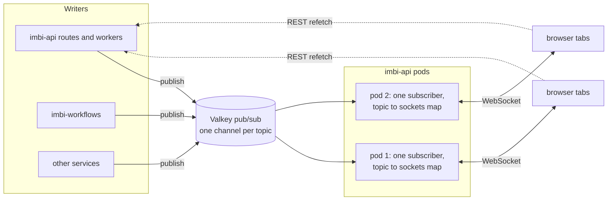

# ADR 0023: Realtime Channel Between the UI and the Services

Date: 2026-10-23

## Status

Proposed

Related: [ADR 0002](0002-authentication-and-authorization-architecture.md)
(authentication), [ADR 0019](0019-apache-iggy-message-streaming.md)
(Iggy), [ADR 0020](0020-agent-task-contract.md) (agent tasks),
[ADR 0021](0021-workflow-contract.md) (workflows).

## Context

### Open pages show stale data

The UI shows a change only after it fetches the current state. A change
made by another person, an agent, a webhook, or a background job
appears on an open page only after the page refetches, either on a
polling interval or when the user reloads.

Deploys show the problem. Imbi starts a deploy run in one of four ways.
A direct deploy deploys a commit from the Deploy button. A rollback
deploys an earlier commit. A promote moves a release to the next
environment, either by dispatching a release build, a GitHub workflow
that creates the tag and the Release, or by starting the deploy run
itself. The UI calls the second kind of promote an inline promote.

When a user clicks Deploy, `DeploymentRunWatcher` polls the run from
that user's browser and keeps a toast up to date. Other users on the
project's deployments tab see nothing. Their page loads deploys with the
`currentReleases` query, which uses the global defaults in
`ui/src/lib/queryClient.ts`. Those defaults set a `staleTime` of five
minutes and turn off refetch on window focus, so an open page never
refetches the list on its own. Until
[#534](https://github.com/AWeber-Imbi/imbi/pull/534), a deploy of a
commit with no Release was not recorded at all, so a reload did not
show it either.

### Each live feature polls on its own

Features that update while a page is open each implement their own
polling loop:

| File | Interval | Watches |
|---|---|---|
| `components/deploy/DeploymentRunWatcher.tsx` | 4 s | A direct deploy, rollback, or inline promote, in the browser that started it |
| `components/deploy/ReleaseBuildWatcher.tsx` | 6 s | A release build |
| `components/releases/releaseInFlight.tsx` | 6 s | A promote |
| `components/agents/taskQueries.ts` | 3 s, 15 s | Task events, the inbox, the "waiting on you" count |
| `components/workflows/workflowQueries.ts` | 2 s | Open workflow runs |
| `hooks/useCommitSync.ts`, `usePRSync.ts`, `useDeploymentResync.ts`, `useMaintenanceOperations.ts` | 3 s | Background syncs and maintenance operations |
| `hooks/useDocumentPresence.ts` | 10 s | The "currently editing" heartbeat for documents |
| `components/admin/AgentRunners.tsx` | 15 s | Runner status |

### The decision depends on these facts

1. **Pages read all data through permission-checked REST endpoints.**
   The UI caches each response with TanStack Query, and
   `ui/src/lib/queryKeys.ts` defines every query key in one place, so
   the UI can refetch any resource by its key.
2. **Writes happen in more than one process.** imbi-api makes most
   writes, including those to agent tasks, comments, and deployments.
   imbi-workflows writes run state, and other services write the graph
   directly.
3. **GitHub owns the status of deploy runs.** A promote that dispatches
   a release build has a server-side watch job in
   `release_promote/queue.py`. Direct deploys, rollbacks, and inline
   promotes have none. Imbi records their status only when a GitHub
   webhook arrives, when a user runs a manual resync, or when a page
   loads. Every call to `list_current_releases` asks GitHub about each
   in-flight run it returns (`_reconcile_in_flight_run` in
   `releases.py`).
4. **Valkey is required in practice.** Only imbi-api connects to Valkey
   today. `VALKEY_URL` defaults to `valkey://localhost:6379/0`, so
   imbi-api starts without it set. Nothing serves that address in the
   pod, so imbi-api's workers start and then fail on their first
   command.
5. **imbi-api can run more than one pod.** `service.api.replicas` in the
   Helm chart sets the pod count. The Kubernetes Deployment uses the
   default rolling update, so even with one replica, an old pod and a
   new pod both serve traffic during a rollout.
6. **WebSockets can authenticate with the existing access cookie.** The
   browser `WebSocket` API cannot set request headers, so the UI cannot
   send the bearer token it uses for REST calls. The browser does send
   cookies with the handshake, the HTTP request that opens the
   connection. imbi-api already copies the access token into the
   `imbi_access_token` cookie so that `` requests to the upload
   endpoints are authenticated. The cookie's path is the API prefix, so
   the browser sends it to any endpoint under that prefix. It is
   `HttpOnly` and `SameSite=Strict`, and it expires with the access
   token (one hour by default).
7. **The stack already supports WebSockets.** imbi-common depends on
   `uvicorn[standard]`, which installs the `websockets` library. Caddy's
   `/api/*` route proxies WebSocket handshakes with no extra
   configuration.

## Decision

Each browser tab opens one WebSocket to imbi-api, and every feature on
the page shares it. Over the socket, the browser subscribes to topics,
each of which covers one scope such as a project or a document. When
something on a topic changes, the writer publishes an event to Valkey
pub/sub. Every imbi-api pod receives the event and sends it to its own
sockets that subscribe to the topic. The event names the resource that
changed, and the browser refetches that resource through REST.

Presence, the record of who is viewing or editing a page, moves onto
the same socket. Presence is why the channel is a WebSocket. The
browser sends presence updates as often as the server sends events, and
a WebSocket carries messages in both directions. Server-Sent Events
(SSE) only carry messages from server to browser, so presence would need
a second channel. See [Alternatives Considered](#alternatives-considered).



### Topics

imbi-api keeps a registry with one entry per topic type. Each entry
names the permission that the matching REST read requires, and imbi-api
checks that permission when a browser subscribes.

| Topic | Read permission |
|---|---|
| `org:<org>` | Membership |
| `project:<org>:<project_id>` | `project:read` |
| `agent:<org>:<slug>` | `agent:read` |
| `prompt:<org>:<slug>` | `prompt:read` |
| `workflow:<org>:<slug>` | `workflow:read` |
| `document:<org>:<document_id>` | `document:read` |
| `task:<org>:<short_id>` | `agent_task:read` |
| `user:<user_id>` | Only that user |

Every topic except `user:` includes the organization, as the document
presence keys do. To authorize a subscribe, imbi-api calls
`imbi.api.auth.organizations.check_member` for that organization, then
checks the entry's permission. Adding a topic type means adding one
registry entry.

### Messages

All messages are JSON.

```jsonc
// browser to server
{"type": "subscribe", "topic": "project:acme:abc123"}
{"type": "unsubscribe", "topic": "project:acme:abc123"}
{"type": "presence", "topic": "agent:acme:triage", "state": {"editing": "system_prompt"}}

// server to browser
{"type": "subscribed", "topic": "project:acme:abc123"}
{"type": "invalidate", "topic": "project:acme:abc123", "resource": "deployments", "actor": "alexc@aweber.com"}
{"type": "presence", "topic": "agent:acme:triage", "members": [{"user": "...", "state": {"editing": "system_prompt"}}]}
{"type": "notify", "topic": "user:42", "level": "success", "title": "Deployed abc1234 to testing", "url": "/projects/abc123/deployments"}
{"type": "error", "topic": "project:acme:abc123", "code": "forbidden"}
```

- **`subscribed`** confirms that a subscription is active.
  [Delivery](#delivery) explains why the browser waits for it.
- **`invalidate`** says that a resource on a topic changed, and who
  changed it. Most messages are this type. It carries identifiers only,
  never the changed data, so the browser refetches through REST and the
  REST endpoint checks permissions again. A bug in topic authorization
  can therefore expose only that a resource changed and who changed it.
- **`presence`** is short-lived state about who is on a topic and what
  they are doing. Each topic type defines and validates its own state
  shape.
- **`notify`** is a message for one person, shown as a toast. It is
  allowed only on `user:` topics, so only that person sees its text.
- **`error`** reports a refused subscribe or a malformed message. The
  socket stays open.

### Publishing events

`imbi.common.realtime.publish(topic, event)` publishes a Pydantic model
to the Valkey pub/sub channel `imbi:rt:<topic>`.

- Code that writes calls `publish` after the write commits. Where a
  write already publishes an audit or domain row to Iggy
  (`operations_log`, `events`), it calls `publish` in the same place.
- Each writer calls `publish` itself instead of relying on HTTP
  middleware, because webhooks, sweepers, agent tasks, and workflow
  steps write without an HTTP request.
- `publish` never raises. It retries a failed publish once, then logs
  and counts the failure, as document presence does during a Valkey
  outage. [Delivery](#delivery) covers how the browser recovers.
- `publish` counts published events and publish errors by topic type,
  following the pattern of `imbi_iggy_published_total`.
- A service other than imbi-api adds `valkey.valkey_lifespan` when it
  starts publishing. imbi-workflows is the first, to publish run
  progress.

A contract test catches write routes that forget to publish. It lists
every mutating route in imbi-api and fails for any route that neither
publishes an event nor appears on an exemption list with a reason.
Writers outside HTTP routes rely on code review.

### The `/realtime` endpoint

imbi-api serves the WebSocket at `/realtime` under its route prefix.

- **The handshake authenticates with the access cookie.** imbi-api reads
  the cookie with the same resolver as
  `require_permission(..., allow_cookie=True)`. That resolver already
  refuses agent API tokens in the cookie, so the endpoint refuses them
  too.
- **The `Origin` header must match** the public URL or an entry in
  `cors_allowed_origins`. `SameSite=Strict` already stops the browser
  from sending the cookie on a cross-site handshake. The `Origin` check
  is a second defense against cross-site WebSocket hijacking.
- **Each subscribe is authorized** with the check from the topic's
  registry entry.
- **Permission changes apply to open sockets.** A write that changes
  what a user can read, such as an organization membership, a role
  assignment, or a role's permissions, publishes a `permissions` event.
  The event names the user, or the organization for a role change. It
  goes on the internal channel `imbi:rt:permissions`, which every pod
  always subscribes to and browsers cannot subscribe to. Every pod
  receives every permission change, which costs little because
  permission changes are rare. Each pod reauthorizes the subscriptions
  of its sockets that belong to the named user, or to a member of the
  named organization. It drops each subscription that fails and sends
  an `error` message for it.
- **The socket closes when the access token expires.** When the token's
  `exp` passes, the server closes the socket with code `4401`. The
  browser refreshes the token through the normal flow and reconnects.
  This also limits how long a connection lives, which
  [Multiple pods](#multiple-pods) relies on.
- **The server pings every 25 seconds** so that proxies and load
  balancers do not close an idle socket.
- **Limits** cap topics per socket, message size, and presence updates
  per second.

Each imbi-api process holds one Valkey pub/sub connection, shared by all
its sockets. An in-memory map from topic to sockets sends each event to
the sockets subscribed to its topic. The process subscribes to a
channel when the first local socket subscribes to that topic, and
unsubscribes when the last one leaves.

The Helm chart documents Valkey as a required backing service.

### The browser

- **`RealtimeProvider`** manages the tab's socket. It connects,
  reconnects with backoff and a random delay, refreshes the token after
  a `4401` close, and shows `notify` toasts. It keeps its state in a
  zustand store.
- **`useTopic(topic)`** subscribes while a component is mounted. Several
  components can use the same topic, and the topic stays subscribed
  until the last one unmounts.
- **The invalidation bridge** is one table that maps each `resource`
  value to `queryKeys` builders. On an `invalidate` event, it calls
  `queryClient.invalidateQueries` for those keys. A query whose key is
  in the table updates live with no change to its component.
- **`usePresence(topic, state)`** sends the caller's state and returns
  the other members.
- **One fallback replaces per-feature polling.** While the socket is
  down, `RealtimeProvider` refetches every subscribed topic's queries
  every 30 seconds.

### Delivery

Valkey pub/sub delivers each event at most once, and events from
different publishers arrive in no guaranteed order. The design tolerates
both because an event only tells the browser to refetch. Two refetches
give the same result as one, so order does not matter, and the browser
recovers from a missed event by refetching. A missed `notify` is lost,
but it only repeats information that pages show anyway.

The browser can miss an event in four ways, and recovers from each:

- **An event sent while the socket is down.** After it reconnects, the
  browser refetches every topic it subscribes to.
- **A write made between a REST read and the subscription.** The server
  sends `subscribed` only once its Valkey subscription for the topic is
  active. When `subscribed` arrives, the browser refetches the topic's
  queries that started before it. This happens on the first subscribe
  and on every reconnect. As a result those queries load twice. The
  implementation can avoid the second load by delaying a topic's
  queries until `subscribed` arrives, whenever the socket is open.
- **An event published while a pod's Valkey subscriber is
  disconnected.** When that connection drops, the pod closes its
  sockets with code `1013` (try again later) and refuses new ones until
  the subscriber reconnects. Until the browsers reconnect, they use the
  30-second fallback.
- **A publish that fails after its retry.** The writer cannot tell which
  browsers missed it. The page stays stale until the next event on the
  topic, a reload, or the user returning to a hidden tab, because the
  browser refetches its subscribed topics when a hidden tab becomes
  visible.

### Multiple pods

The design needs no sticky sessions.

- A WebSocket is one long-lived TCP connection. The load balancer picks
  a pod at the handshake, and the connection stays on that pod until it
  closes.
- The only state a pod keeps is each socket's subscription list, which
  it discards when the socket closes. Presence state is in Valkey.
- A pod forwards every event it receives from Valkey to its own
  subscribed sockets, whichever pod or service published it.
- A reconnect can reach any pod. The browser sends its subscriptions and
  presence state again, then refetches.

Running more than one pod has three consequences that the design
handles:

- **A rollout or scale-down closes every socket on a pod at once.** On
  shutdown the server closes its sockets with code `1012` (service
  restart). Browsers reconnect after a random delay, so they do not all
  reconnect and refetch in the same second.
- **Connections do not rebalance on their own.** After a scale-up, old
  sockets stay on old pods. Because the server closes each socket when
  its token expires, connections spread over all pods within one token
  lifetime.
- **Every pod needs Valkey, even with one replica.** Writers in other
  services publish through Valkey, and during a rollout the old and new
  pods each hold sockets.

### Presence

Presence updates move from the HTTP heartbeat in `useDocumentPresence`
to the socket.

- Each topic has a Valkey sorted set of members scored by expiry time,
  as `document_presence.py` does today. Each member records a user and
  that socket's current state for the topic.
- The server refreshes a member while its socket is open and removes it
  when the socket closes. If a pod crashes, its members expire after
  the TTL.
- When the member set changes, the server publishes a `presence` message
  on the topic.
- Presence is never stored past the TTL and never sent to ClickHouse.

### Deploy status

When another system owns some state, one server-side job polls that
system and publishes each change. Browsers never poll it.

Deploys are the first case. Every direct deploy, rollback, and inline
promote starts a watch job like the promote jobs in
`release_promote/queue.py`. The job polls the run, records each status
change, and publishes `invalidate` on the project topic for each one.
When the run ends, the job publishes `notify` to the user who started
it, so that person sees the outcome on any page, in any tab.

`list_current_releases` still asks GitHub about in-flight runs, but only
about runs that their watch job has not updated in five minutes. That
check recovers a run whose watch job died, and other page loads no
longer call GitHub.

### Relation to Iggy

Iggy (ADR 0019) is the durable record, and the message bus for services
that must process every message. The realtime channel is for open
browsers and stores nothing. A write that matters to both publishes to
both. A consumer of the planned Iggy `notifications` stream could
publish `notify` to `user:<id>`, so a notification appears in an open
tab immediately and also goes out by Slack or email.

## What this enables

Each item is a separate feature, tracked as its own GitHub issue once
this ADR is accepted:

- Conflict-safe saves for agents, prompts, workflows, and documents, with
  a notice when another person saves a newer version.
- Presence indicators on project, agent, prompt, and workflow pages.
- A warning when two people are about to deploy to the same environment.
- Active agent tasks shown on the pages of the projects they work on.
- Live comments on documents.
- Notifications on the `user:` topic, such as mentions and tasks waiting
  on you.
- A live webhook history for administrators.
- A "new version deployed" banner.
- Collaborative editing, which needs its own ADR.

## Implementation

The work is one pull request for the core, then one per migration. Each
pull request deletes the code it replaces. They can ship in the same
release.

1. **The core and deployments.** They go in one pull request because
   deployments are the first feature that uses the core, and the core
   cannot be tested end to end without one.
   - The channel, the topic registry, `RealtimeProvider`, `useTopic`,
     the invalidation bridge, the fallback, and the contract test.
   - The deploy watch job, the `notify` on completion, and the limited
     GitHub check in `list_current_releases`.
   - Done when a second browser on the project shows a deploy within two
     seconds, on the environments card and in `CurrentlyRunningCard`,
     and shows each status change.
2. **Presence.** Move document presence onto the socket.
3. **The remaining pollers.** One pull request for each remaining poller
   in the [polling table](#each-live-feature-polls-on-its-own).

## What this removes

[#533](https://github.com/AWeber-Imbi/imbi/pull/533) already removed the
unused deploy and promote modal, about 2,200 source lines and 1,000 test
lines, along with the deploy banner that only that modal used. The
counts below are in addition to #533.

| Step | Deleted | Reduced |
|---|---|---|
| 1 | `DeploymentRunWatcher` (200 lines, 186 test), `ReleaseBuildWatcher` (279, 280 test), `useAdoptInFlightPromote` (125, 203 test), GET `.../deployments/runs/{run_id}` and its UI function | The watcher wiring in `ProjectDetail.tsx`, the `onRunStarted` and `onBuildStarted` callbacks through the deployments and releases components, the polling in `releaseInFlight.tsx`, and `releaseBuildHandoff.tsx` (84 to about 15 lines) |
| 2 | `useDocumentPresence` (56, 73 test), `document_presence.py` and its three routes (146, 153 test), their UI endpoint functions, query key, and generated types | |
| 3 | | The `refetchInterval` options and their constants in the sync hooks, `taskQueries.ts`, `workflowQueries.ts`, `useMaintenanceOperations.ts`, and `AgentRunners.tsx` |

Steps 1 and 2 delete about 830 source lines and 900 test lines
outright, plus the reductions.

GET `.../deployments/runs/{run_id}` is also an MCP and agent tool, so
the release notes announce its removal. Once the watch job records each
status change, agents can read deploy status from the deployment
endpoints, which are also tools. Agents store their tools by name, so an
agent whose saved tools include the removed tool would lose deploy
status. The pull request that removes the endpoint also saves a new
version of each such agent, with the current-releases tool in place of
the removed one.

GET `.../deployments/promote-status` and the `sync-status` endpoints for
deployments, commits, and pull requests stay. Page loads read them, and
every `invalidate` event refetches them.

## Not decided here

- Collaborative editing, including a `doc` message type, the CRDT
  library, and where to store the update log.
- A notification center with unread state. Unread state must persist,
  so it needs a durable store.
- Realtime access for agent API tokens, MCP clients, and other
  non-browser clients.
- Autoscaling imbi-api.

## Consequences

### Benefits

- An open page shows changes from other people, agents, webhooks, and
  jobs within about a second.
- Server load grows with the number of changes instead of the number of
  open tabs. An idle tab sends one ping every 25 seconds.
- One watch job polls GitHub for each deploy run. Page loads call
  GitHub only to recover a run whose watch job died.

### Costs and risks

- imbi-api holds long-lived connections. An imbi-api rollout closes them
  all, and every connected browser reconnects and refetches. The random
  reconnect delay spreads that load, but each rollout still causes a
  burst of requests.
- imbi-workflows, and any other service that publishes, depends on
  Valkey. A Valkey outage stops live updates, but no request fails.
  Pages fall back to the 30-second refresh.
- Each write that matters to the UI needs an explicit `publish` call.
  The contract test covers HTTP routes. A missed call elsewhere leaves
  pages stale until their next refetch.
- A permission removed from a user takes effect on open subscriptions
  when the `permissions` event arrives. If that event is lost, it takes
  effect at the next reconnect, at most one token lifetime later. Until
  then the socket still receives the actors in `invalidate` events and
  the presence state for topics the user can no longer read. Refetches
  check permissions, so no resource data is exposed.
- MCP clients and agents lose the run-status tool. Saved agents that use
  it get a new version with its replacement.
- The WebSocket endpoint is not in the OpenAPI schema. This ADR and the
  client types document the protocol.

## Alternatives Considered

### Polling with shorter intervals

Set a short `staleTime` and refetch on window focus. This is the
smallest change, and it fixes part of the deploy case. We rejected it as
the long-term design because load grows with open tabs, every page load
calls GitHub, and polling cannot carry presence. A 30-second refresh
stays as the fallback when the socket is down.

### Server-Sent Events with POST for messages to the server

SSE would be enough for `invalidate`. Presence would need a POST for
each update, which makes two channels with separate failure modes.
`EventSource` cannot set headers either, so it has no authentication
advantage. Each SSE stream also holds one of the six HTTP/1.1
connections a browser allows per origin, unless every hop uses HTTP/2.

### A separate realtime service

An `imbi-realtime` service would keep long-lived connections apart from
REST traffic and scale on its own. We rejected it for now. Every service
ships in one image and releases together, so a separate service would
still close every socket at each release. It would also add a console
script, a Caddy route, and a Helm mode. The protocol stays the same if
the endpoint moves later.

### Iggy as the fan-out bus

Iggy is durable, has one partition per topic, and keeps consumer-group
offsets on the server. Each imbi-api pod would need its own consumer
state for messages that nobody needs after a second, and persistence
would add latency and storage for no benefit. We rejected it.

### Valkey Streams in place of pub/sub

Streams keep history, so a reconnecting browser could replay missed
events. Refetching after a reconnect gives the same result with no
history to trim, so we rejected Streams for now. They stay an option if
a feature needs replay.

### Sticky sessions and fan-out in memory

Writers in other services and the pod overlap during a rollout need a
shared bus in any case. With the bus, sticky sessions add nothing, so we
rejected them.

### Events that carry data

An `invalidate` event could carry the new row so the browser skips the
refetch. Every event would then need its own permission filtering for
each subscriber, and the REST endpoints would no longer be the only read
path. We rejected it.

### A hosted or third-party realtime server

Socket.IO, Centrifugo, Pusher, and Ably all solve fan-out. Each adds a
service or vendor, a second authentication path, and a protocol to
learn. The protocol here is small, and Valkey and imbi-api already
provide everything it needs, so we rejected them.
