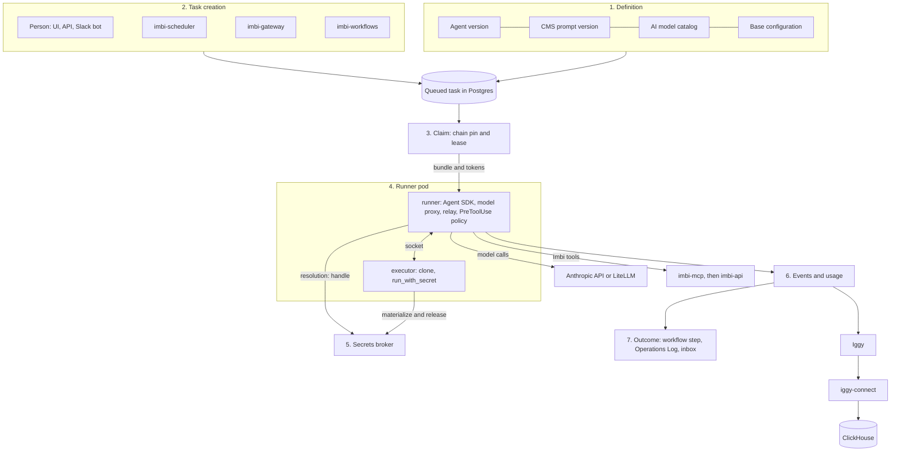

# Agent Runtime

This page shows how an agent task goes from its definition to its
outcome. It names the parts and links to the pages that give the detail.
For the contract, see
[ADR 0020](../api/adr/0020-agent-task-contract.md). For the runner and
the secrets broker, see
[ADR 0022](../api/adr/0022-agent-harness-and-secrets-broker.md).

## 1. Definition

An **agent** is a node in the graph of one organization. It has an owner
team, tools, plugins, subagents, and limits. Each save writes an agent
version. Imbi also makes a service account for the agent. See
[Agents](../admin/agents.md).

The system prompt, the model, and the model parameters are a prompt in
the [prompt CMS](../admin/prompts.md): `agents/<org>.<agent>@stable`. The
agent version records the prompt version. The model comes from the
[AI model catalog](../admin/ai-models.md). The catalog also gives the
prices that Imbi uses to calculate the cost.

Each organization has one **base configuration**: the model upstream and
its key reference, the permission mode, the sandbox, the allowed and
denied tools, the hooks, and the plugin marketplaces. An agent can only
make it stricter.

## 2. Task creation

A task is a row in the `agent_runtime` schema in Postgres. It starts as
`queued`. When Imbi creates it, Imbi pins the agent version, the prompt
version, and the base configuration version. A later change to the agent
does not change a task that exists.

| Origin | Made by |
|---|---|
| `human` | A person in the UI, with the API, or through the Slack bot |
| `schedule` | imbi-scheduler, from a scheduled task with an `api` target |
| `webhook` | imbi-gateway, from the `create_agent_task` action. The delivery must have a verified signature |
| `task` | A parent task, when its agent delegates to a subagent |

A workflow `agent` step also makes a task. The task keeps the origin of
the workflow run. imbi-workflows reads the task until it closes, then
continues the run. See [Agent Tasks](../admin/agent-tasks.md#triggers)
and [Workflows](../admin/workflows.md).

## 3. Dispatch and leases

Runners pull work. imbi-api does not push it.

1. A runner registers with the pool credential. It gets a runner
   credential and an executor credential.
2. It long-polls `POST /harness/runners/{id}/claim`. imbi-api gives it the
   oldest queued task that it can run: the agent is enabled and under
   its `max_concurrent_tasks`, the pool serves the organization, and the
   runner has every label that the agent requires.
3. The claim pins the **chain** (the root task and its child tasks) to
   the runner, in one attempt. The response holds the task, the identity
   bundle, an agent token, and an agent API token.
4. The runner heartbeats. Each heartbeat renews the 60 second lease and
   the agent API tokens.

The identity bundle comes only from the pinned versions. It has the
rendered system prompt, the model, the merged configuration, the
repository to clone, the subagents, the third-party MCP servers, and the
secret references that the grants allow.

When a lease expires, the lease sweep marks the runner lost and moves the
chain to `fencing` with the next attempt. The agent tokens of the old
attempt stop at once. The sweep releases the runner's secrets. If that
fails, the chain is `stuck` and the sweep tries again. After 120 seconds
of grace, the chain goes back to the queue. See
[Agent Runners](../deployment/agent-runners.md).

## 4. The runner pod

A runner pod has two containers from the `imbi-harness` image:

| Container | What it does |
|---|---|
| `runner` | Runs the Claude Agent SDK and the CLI. Holds the tokens, the model proxy, and the relay. Writes the task events |
| `executor` | Holds the executor credential. Clones repositories, and runs `run_with_secret` commands |

The model and its tools run as the unprivileged `agent` user. The `agent`
user cannot read the tokens, the executor socket, or the other
container. The runner holds one chain, then removes the workspace and
exits.

The runner has these parts:

- **Model proxy.** One loopback proxy for each task. The CLI gets the
  proxy address and a placeholder key. The proxy adds the real model key
  and forwards only `POST /v1/messages` and
  `POST /v1/messages/count_tokens` to the upstream (the Anthropic API or a
  LiteLLM gateway). It reads the token usage of each response. When the
  budget is spent, it refuses the next call.
- **Imbi relay.** The runner is the MCP client of imbi-mcp. It calls with
  the agent API token, which the model never sees. The model gets only
  the Imbi tools that the agent's tool map has. imbi-api checks the
  permissions of the agent's service account on each call. See
  [Agent API tokens](security.md#agent-api-tokens).
- **Third-party MCP relay.** The runner also calls the agent's other MCP
  servers. It gets their credentials from the secrets broker. It connects
  only over HTTPS, to the configured origin, at a public address.
- **PreToolUse policy.** A hook checks each tool call before the CLI runs
  it:
    1. A built-in tool must be in the allowed tools of the merged
       configuration. An MCP tool must be in the agent's tool map.
    2. An `environment` argument must not name a blocked environment.
    3. A tool with approval set opens a request, and the task waits for a
       person (`blocked`). A tool in `approval_tools` also needs approval
       when no person started the task.
    4. imbi-api counts the call against its rate limit.

## 5. Secrets broker

The runner never gets a secret value from imbi-api directly:

1. The runner asks for a resolution with its agent token
   (`POST /harness/secret-resolutions`). imbi-api takes the organization,
   agent, project, task, and runner from the token and the chain. A grant
   must allow the request. imbi-api returns a single-use handle.
2. The runner sends the handle to the executor on the local socket.
3. The executor materializes it with the executor credential
   (`POST /harness/executor/secret-materializations`), just before it runs
   the command.
4. The executor releases the resolution after the command. Imbi also
   releases all resolutions of a task when the task closes, and of a
   runner when its lease expires.

The runner's own setup secrets use the same path, with the purposes
`model_inference`, `workspace_checkout`, `marketplace_fetch`, and
`mcp_server`. The executor gives them to the runner on a file descriptor,
never to a model command. See [Secrets](../admin/secrets.md) and
[Secrets broker](security.md#secrets-broker).

## 6. Events and usage

The runner opens a session on the task and calls the task routes under
`/organizations/{org}/agent-tasks/{short_id}/`: `sessions`, `events`,
`usage`, `requests`, and `outcome`. It redacts each payload before it
sends it.

imbi-api writes each change and its event in one Postgres transaction.
After the commit, it publishes the event to the Iggy topic
`agent_tasks` of the stream `agent_task_events`, and each usage row to the
stream `agent_usage`. iggy-connect writes them to the ClickHouse tables of
the same names. If a publish fails, the archive sweep publishes the row
again. When ClickHouse has all the events of a closed task, the sweep
deletes them from Postgres.

Each usage report returns the task state. When the cost is over the
budget, imbi-api closes the task with `exceeded_ceiling`, and the runner
stops the SDK. The **Agents > Usage** page reads `agent_usage`.

## 7. Outcome

The agent reports its outcome with the `report_outcome` tool. The runner
sets the outcome and closes the task. Then:

- The close hooks release the secrets of the task.
- The outcome goes to the [Operations Log](../admin/agent-tasks.md#operations-log).
- A workflow `agent` step that waits on the task continues.
- The task inbox shows the result. See
  [Outcomes](../admin/agent-tasks.md#outcomes).

When every task of the chain is closed, the runner finishes and exits.
The pool starts a clean pod.
