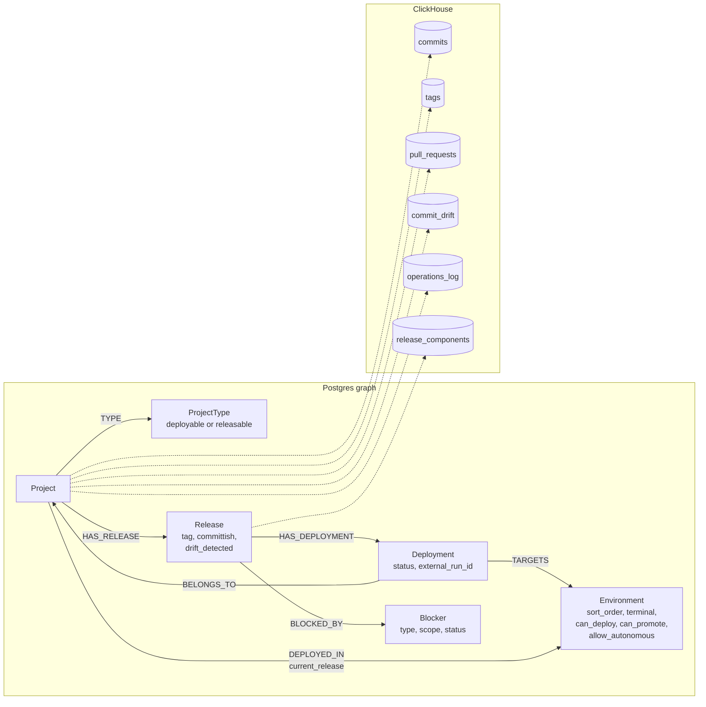

# Delivery Model

This page describes how Imbi records what a project ships: commits, pull
requests, tags, releases, deployments, blockers, and drift. It also
describes how each record gets into Imbi. For how to use these features in
the UI, see [Releases and deployments](../user-guide/releases-and-deployments.md)
and [Drift](../user-guide/drift.md).

## Data model

### In the graph

| Node or edge | What it is |
|---|---|
| `ProjectType` | Sets the delivery shape of its projects. A `deployable` type deploys into environments. A `releasable` type publishes an artifact with a tag and a release, and has no deploy step. A type can be one, or neither, but not both |
| `Environment` | One environment of an organization. `sort_order` puts the environments in pipeline order. `terminal` ends a pipeline, so the next environment starts a new one. `can_deploy` and `can_promote` turn the actions on for that environment. `allow_autonomous` lets a principal with no user (a service account that uses the credential of an integration) deploy or promote into it |
| `Release` | A version of a project. It has a 7-character `committish` (short SHA) and an optional `tag`. A tag must match the tag formats of the organization or the project type |
| `Deployment` | One rollout of a release (or of a commit) into one environment. Its identity is the project and the remote run id, so every writer that learns about one rollout updates the same node. Its status is `pending`, `in_progress`, `success`, `failed`, or `rolled_back` |
| `(Project)-[:DEPLOYED_IN]->(Environment)` | The current release of the project in that environment, in the `current_release` property, with the time and the source of that information |
| `Blocker` | Something that must be fixed before a release ships. See [Blockers](#blockers) |

A `Deployment` can exist before its `Release`. The gateway can record a
deployment for a project and an environment when no release matches yet.
The `deployment-sweep` maintenance operation attaches it to the release
later.

Older deployments are entries in a `deployments` array on a
`(Release)-[:DEPLOYED_TO]->(Environment)` edge. Nothing writes that array
now. The read paths combine the old entries with the `Deployment` nodes.

### In ClickHouse

| Table | Holds | Written by |
|---|---|---|
| `commits` | The commits of the default branch | Commit sync |
| `tags` | The tags of the repository | Commit sync |
| `pull_requests` | Pull requests and their state | Pull request sync |
| `commit_drift` | One CI drift verdict for each commit | Drift ingest |
| `operations_log` | Deployments and other changes, with who made them | imbi-api |
| `release_components`, `release_component_batches` | The SBOM components of each release | SBOM ingest |

All of these tables get their rows through Iggy. See
[Events and analytics](events.md).

## Deploy and promote

A user or a principal starts both actions with
`POST /organizations/{org_slug}/projects/{project_id}/deployments` (under
the imbi-api route prefix). imbi-api resolves the deployment
plugin of the project (for example GitHub) and calls it.

- **Deploy** (`action: deploy` or `redeploy`) ships a commit or a tag to
  one environment. A rollback is a `redeploy` of an earlier ref.
- **Promote** (`action: promote`) ships the build that runs in one
  environment to the next one:
    - If the ref is already a tag, imbi-api starts the deployment of that
      tag.
    - If the ref is a commit SHA, imbi-api cuts a new tag at the commit,
      upserts the `Release`, and starts the deployment of the tag.
    - If the project has a release workflow (the `artifact_workflow`
      option of the deployment capability), imbi-api starts that workflow
      and returns. The workflow builds the artifact and cuts the tag. The
      release promote worker in imbi-api watches the build. When the build
      succeeds, the worker refreshes the release, creates the deployment,
      and watches the rollout. When the build fails, the worker blocks the
      release. The UI reads the progress from the `promote_*` properties of
      the project.

The remote release (for example a GitHub Release) is not created at
promote time. It is published after the rollout succeeds.

Before it starts an action, imbi-api checks these conditions:

1. The environment allows the action (`can_deploy` or `can_promote`), and
   `allow_autonomous` when the principal has no user.
2. No open blocker refuses the release.
3. For a promote, no other release of the project is in flight.
4. CI did not fail for the commit.

### CI gating

imbi-api asks the deployment plugin for the CI status of the commit
(`get_check_status`). For a promote, it asks about the commit on the
default branch, not about the tag.

- Only `fail` gates. `warn` (a cancelled or stale run) and `unknown` (no
  CI, or no access to the check runs) do not gate.
- On `fail`, imbi-api returns 409. To continue, the caller sends the
  request again with `acknowledge_ci_failure: true`. imbi-api records the
  override on the release.
- A principal with no user cannot acknowledge a CI failure. That flag
  states that a person looked at the failed checks.

### Blockers

A `Blocker` hangs off a release through `BLOCKED_BY`. While a blocker is
`open`, imbi-api refuses every deploy and promote of that release with 409,
and lists the blockers.

| Field | Values |
|---|---|
| `type` | `build-failure`, `drift`, `product-review`, `qa`, `deploy-order`, `dependency`, `manual`. A label only: each type has the same effect |
| `scope` | `commit` (default) refuses every release with the same committish, also under another tag. `tag` refuses only that version, so that you can promote a new version from the same commit |
| `status` | `open` or `resolved`. Resolve a blocker to keep its record. Delete is for mistakes and needs an admin |
| `external_ref` | A handle that an outside process (a CI job, an agent) uses to find and resolve its own blocker |

These parts of Imbi file blockers:

- A user, from the UI or the API.
- The `block_release` gateway action.
- The release promote worker, when a release build fails.
- The drift ingest, when CI reports drift for a tagged release (type
  `drift`). A later verdict that is not `true` resolves it.

## Current release of an environment

The `current_release` property on `DEPLOYED_IN` says which release runs in
each environment. Two writers set it:

- **A successful deployment event.** The pointer moves to the release of
  the event, but only when the event is newer than the stored time. Thus a
  replay of an old event cannot move it back.
- **Deployment sync.** It asks the plugin which deployment is active in
  each environment. When the plugin knows, the pointer moves to that
  release, or clears when nothing is active. When the plugin does not know,
  or fails, the pointer stays as it is.

## How records get in

| Record | Webhook path (imbi-gateway) | On demand (imbi-api worker) | Maintenance operation |
|---|---|---|---|
| Commits and tags | `push` deliveries run the `sync_commits` and `sync_tags` actions | **Sync Commits & Tags** on a project | `commit-sync` |
| Pull requests | `pull_request` deliveries run `sync_pull_requests` | **Sync Pull Requests** on a project | `pr-sync` |
| Releases | `create_release`, `publish_release`, and `block_release` actions | Promote | `orphan-release-check`, `orphan-release-purge` |
| Deployments | `add_deployment_event` (for example from `deployment_status`) | **Sync Deployments** on a project, and the promote watcher | `deployment-resync`, `deployment-sweep` |
| Drift verdicts | `update_release_drift` (a push to the notes ref) | Commit sync reads the notes of the commits it records | `deployment-sweep` |
| SBOM components | `ingest_sbom` | | |

- An on-demand sync puts a job on a Valkey stream. A worker in imbi-api
  runs it with the service credential of the integration, and writes the
  status of the last run on the `Project` node. The UI reads that status.
  See [Background workers](overview.md#background-workers-in-imbi-api).
- `deployment-sweep` asks the remote about each deployment that is still
  running after 30 minutes. It marks a deployment `failed` when nothing can
  resolve it for a week. It also attaches early deployments to their
  release, and reads drift verdicts for releases that have none.
- Imbi does not schedule `deployment-sweep` by itself. Run it from the
  Maintenance page, or create an imbi-scheduler task that calls it. See
  [Maintenance](../admin/maintenance.md).
- The webhook actions run only when the integration has the
  webhook-actions capability turned on and a webhook rule selects them. See
  [Webhooks](../admin/webhooks.md).

## Drift

Imbi uses the word "drift" for three different things. Do not mix them.

| Kind | Question | Shown as | Source |
|---|---|---|---|
| Environment drift | Do two adjacent environments run different code? | `from -> to` badges (for example `T -> S`) on deployable projects | The current release of each environment |
| Release drift (`C -> R`) | Are there commits after the latest tag? | A `C -> R` badge on releasable projects | `commits` and `tags` in ClickHouse |
| CI drift verdict | Did CI say that this commit changes what ships? | `Release.drift_detected`, and a `drift` blocker | Git notes in `refs/notes/imbi-drift` |

### Environment drift

Imbi takes the environments of the organization in `sort_order` and
splits them into pipelines at each `terminal` environment. Each pair of
adjacent environments in a pipeline is a promotion step. A pair drifts
when the two environments run different commits. When both sides have a
commit SHA, Imbi compares the SHAs, so two tags on the same commit do not
drift. Otherwise it compares the tag, or the SHA when there is no tag.

A missing release on one side counts as drift.

### Release drift

A releasable project drifts when the default branch has commits after
the latest tag. The latest tag is the highest version, as on the Releases
tab of the project.

### CI drift verdicts

CI writes a git note for each commit, in the `refs/notes/imbi-drift`
namespace, with JSON such as `{"drift_detected": false}`. Imbi reads the
notes in three ways:

1. A push to the notes ref reaches the gateway. The `update_release_drift`
   action sends the old and new values of the ref to imbi-api, which reads
   the changed notes.
2. Commit sync reads the notes of the commits it records, except the
   commits that already have a verdict.
3. `deployment-sweep` reads the notes for releases that have no verdict
   yet. It asks again after 24 hours at the earliest.

Each verdict becomes a row in `commit_drift`. A verdict for the commit of
a tagged release also sets `Release.drift_detected`, and `true` files the
`drift` blocker. `drift_detected` is `null` until Imbi sees a note.

### The verdict rule

The verdicts filter the first two kinds of drift. A range of commits (the
commits between two environments, or after the latest tag) is clean
**only** when every commit in it has the verdict `false`:

- A `true` verdict shows drift.
- A commit with no verdict shows drift.
- When imbi-api cannot read the verdicts, the range shows drift.

Thus a range of commits that CI never checked stays in the list until
someone promotes past it.

The projects list counts environment drift and release drift. It does
not count `Release.drift_detected`. A project type that is neither
deployable nor releasable shows no drift.
