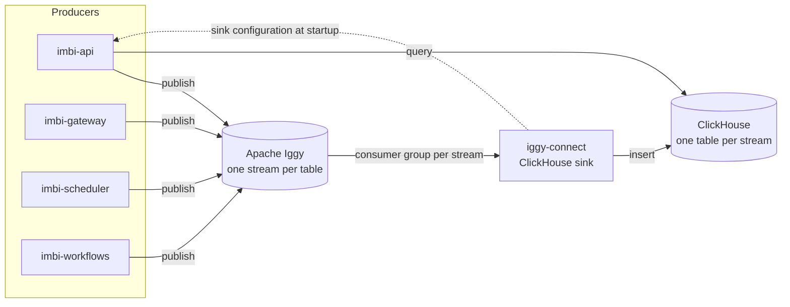

# Events and Analytics

Imbi keeps its analytics rows in ClickHouse. No service writes to
ClickHouse directly. Each service publishes rows to Apache Iggy, and the
Iggy connectors runtime (iggy-connect) writes them to ClickHouse. The
services only read from ClickHouse.

[ADR 0019](../api/adr/0019-apache-iggy-message-streaming.md) records the
decision.

## The pipeline

1. A producer calls `imbi.common.iggy.publish()` with a list of Pydantic
   models. Each model becomes one JSON message.
2. Iggy holds the message in a **stream** and a **topic**. The stream name
   is the name of the ClickHouse table. The topic is the feature that
   made the row, for example `github` or `maintenance`.
3. iggy-connect runs one ClickHouse sink for each stream. Each sink reads
   all the topics of its stream in a consumer group that has the stream
   name. It inserts batches of up to 1000 rows and polls every 250 ms.
4. The services read the tables with `imbi.common.clickhouse.query()`. The
   ClickHouse client in imbi-common has no insert function.

The GitHub plugin also publishes. Its commit and pull request handlers run
in imbi-gateway (webhook actions) and in imbi-api (on-demand syncs).

imbi-workflows can start without Iggy. If it cannot publish, an imbi-api
sweep publishes the run history later. The other producers do not start
without Iggy.

## Topics

`imbi.common.iggy.TOPICS` is the one list of streams and topics. These
parts of Imbi read it:

- **The producers.** At startup, each producer creates each stream and
  topic in the list that does not exist. Each topic has one partition.
- **The sink configuration.** imbi-api makes one sink for each stream in
  the list. See [Sink configuration](#sink-configuration).
- **The metrics.** imbi-api reports the state of each topic and of its
  consumer group.

The table below comes from `TOPICS` and from the ClickHouse schema file,
`libraries/common/src/imbi/common/clickhouse/schemata.toml`. To refresh it,
run `uv run python scripts/docs_iggy_topics.py` and paste the output.

<!-- BEGIN GENERATED: scripts/docs_iggy_topics.py -->

| Stream and ClickHouse table | Topics | Engine | TTL |
|---|---|---|---|
| `agent_task_events` | `agent_tasks` | `ReplacingMergeTree()` | none |
| `agent_usage` | `agent_tasks` | `ReplacingMergeTree()` | none |
| `commit_drift` | `drift` | `ReplacingMergeTree(recorded_at)` | none |
| `commits` | `github`, `maintenance` | `ReplacingMergeTree(recorded_at)` | none |
| `document_read_events` | `documents` | `ReplacingMergeTree(recorded_at)` | `toDateTime(session_started_at) + INTERVAL 90 DAY` |
| `document_read_sessions` | `documents` | `ReplacingMergeTree(finalized_at)` | `toDateTime(started_at) + INTERVAL 2 YEAR` |
| `document_versions` | `documents` | `ReplacingMergeTree(recorded_at)` | none |
| `email_audit` | `email` | `MergeTree()` | `toDateTime(sent_at) + INTERVAL 1 YEAR` |
| `events` | `comments`, `documents`, `gateway`, `lifecycle`, `projects` | `ReplacingMergeTree(version)` | none |
| `maintenance_log` | `maintenance` | `MergeTree()` | `toDateTime(occurred_at) + INTERVAL 90 DAY` |
| `operations_log` | `api`, `configuration`, `deployments`, `maintenance` | `ReplacingMergeTree(_row_version)` | none |
| `pull_requests` | `github` | `ReplacingMergeTree(recorded_at)` | none |
| `release_component_batches` | `sbom` | `MergeTree()` | none |
| `release_components` | `sbom` | `MergeTree()` | none |
| `scheduler_runs` | `scheduler` | `ReplacingMergeTree(_row_version)` | `toDateTime(fired_at) + INTERVAL 90 DAY` |
| `score_history` | `scoring` | `MergeTree()` | none |
| `secret_audit_events` | `secrets` | `ReplacingMergeTree()` | none |
| `tags` | `github` | `ReplacingMergeTree(recorded_at)` | none |
| `workflow_run_events` | `workflows` | `ReplacingMergeTree()` | none |
| `workflow_runs` | `workflows` | `ReplacingMergeTree(_row_version)` | none |

<!-- END GENERATED -->

## Sink configuration

iggy-connect has no sink configuration of its own. At startup it gets the
configuration from imbi-api, at `/iggy/connectors/configs/active` under the
imbi-api route prefix (the path of `IMBI_API_URL`). The response contains
the ClickHouse URL, user name, and password. imbi-api takes them from its
own `CLICKHOUSE_URL`.

The response contains credentials, so the endpoint needs a bearer key:

- Set `IMBI_IGGY_CONNECTORS_API_KEYS` on imbi-api. To rotate a key, put
  two keys in the value, with a comma between them.
- Set the same key as `IGGY_CONNECTORS_API_KEY` on iggy-connect.
- If `IMBI_IGGY_CONNECTORS_API_KEYS` is not set, the endpoint returns 503.
  It never returns the configuration without a key.

The endpoint is not in the OpenAPI schema. Thus it is not in the UI client
and it is not an MCP tool.

## Restart rule for new topics

iggy-connect reads its configuration **one time**, at startup. A stream or
topic that is added to `TOPICS` gets no sink until iggy-connect restarts.

After you deploy a release that adds a stream or a topic:

1. Make sure that imbi-api runs the new release. imbi-api creates the new
   topic at startup.
2. Restart iggy-connect. On Kubernetes, use
   `kubectl rollout restart deployment/<name>`.

iggy-connect stops at startup if imbi-api does not answer, or if a stream
in its configuration does not exist. In both cases, start it again after
imbi-api is up. The Compose file (`restart: on-failure`) and the Helm chart
(a Deployment) do this automatically.

For other Iggy operations, for example a consumer group member that holds
a partition and reads nothing, see [Operations](../deployment/operations.md).

## Table design rules

### ReplacingMergeTree

Iggy delivers a message at least one time. A retry or a second sync can
write the same row again. Thus most tables use `ReplacingMergeTree`.
ClickHouse keeps one row for each sort key when it merges the parts of a
table:

- The sort key (`ORDER BY`) is the identity of a row. Two rows with the
  same key are the same record.
- The version argument, for example `ReplacingMergeTree(recorded_at)`,
  selects the row that stays: the row with the highest version.
- ClickHouse selects the time of a merge. Until the merge, the duplicates
  stay in the table. A query that must see one row for each key uses
  `FINAL`.

Some records change state. For example, a scheduler run has a `running`
row and then a terminal row. The producer writes the new state as a new
row with a higher version (`_row_version`). The merge keeps the newest
state.

Tables that only append use `MergeTree`. Each row in these tables is a
separate fact, for example one email that Imbi sent.

### TTL

A TTL deletes old rows when ClickHouse merges parts. Obey these rules for
a TTL:

- **Use a column that every row of a record has.** ClickHouse evaluates the
  TTL for each row. Think of a record with a `running` row and a terminal
  row, and a TTL column that only the terminal row has. The terminal row
  expires first. The merge then keeps the `running` row, and the record
  shows as still running. For this reason `scheduler_runs` uses
  `fired_at` and `document_read_events` uses `session_started_at`.
- **Do not use `DELETE WHERE` in a TTL.** A condition that keeps some rows
  of a record and deletes others causes the same problem.
- **Put the column in `toDateTime()`.** `DateTime64 + INTERVAL` gives a
  `DateTime64`. ClickHouse refuses it in a TTL with `BAD_TTL_EXPRESSION`.

A table without a TTL keeps its rows. The agent, workflow, and secret
audit tables are audit trails and have no TTL.

### Clusters

Each table engine in `schemata.toml` starts with the `{replicated}`
placeholder. When `CLICKHOUSE_CLUSTER_NAME` is set, the placeholder becomes
`Replicated` and the DDL runs `ON CLUSTER`. When it is not set, the tables
are single-node tables.

### New tables

The services do not create ClickHouse tables when they start.
`imbi-api setup` and `imbi-api setup-clickhouse` apply `schemata.toml`.
After you deploy a release that adds a table, run
`imbi-api setup-clickhouse`. Until you do, a query on the new table fails
with `UNKNOWN_TABLE`.

## Metrics

Each producer that connects through `imbi.common.iggy` counts the messages
it publishes (`imbi_iggy_published_total`) and the failures
(`imbi_iggy_publish_errors_total`), by stream and topic. imbi-api also
reports the state of each topic and of its sink consumer group
(`imbi_iggy_topic_*` gauges). iggy-connect serves its own metrics on port
8081. See [Observability](overview.md#observability).
