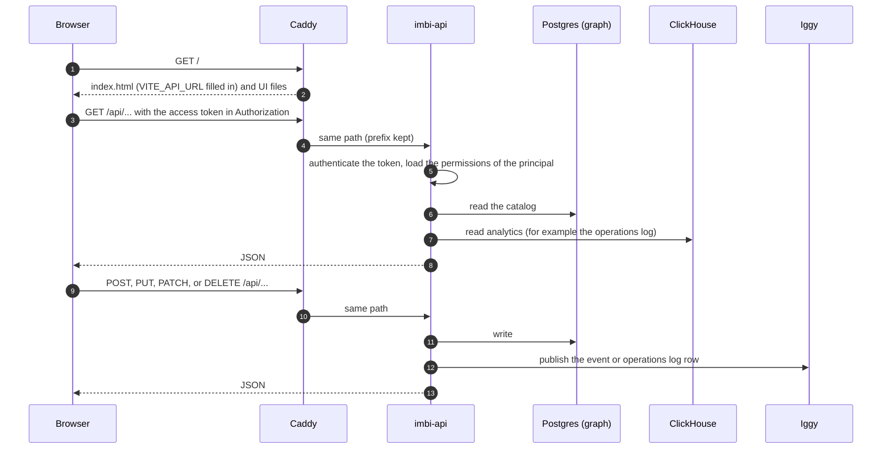
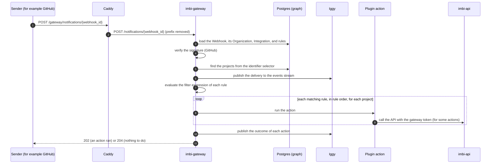
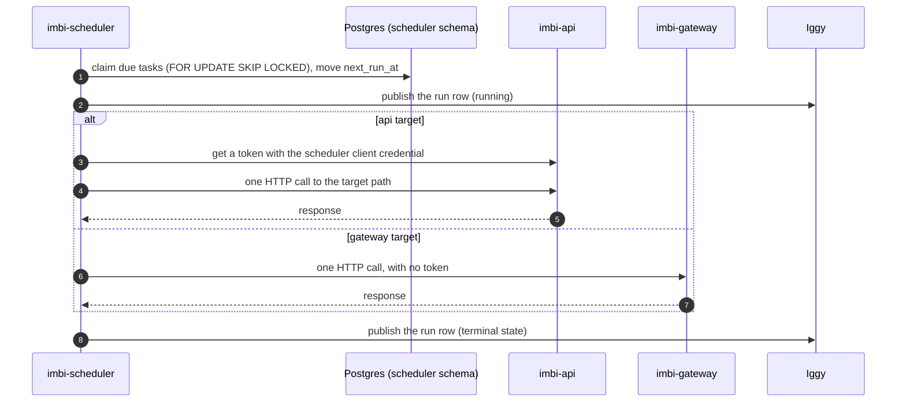
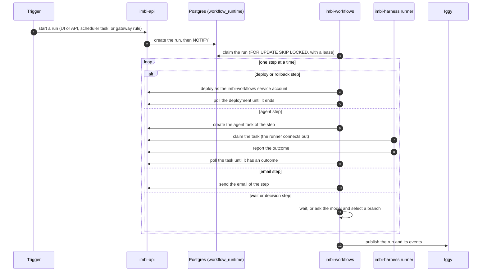

# Request and Trigger Flows

This page shows how work moves through Imbi in four common cases: a
browser request, a webhook, a scheduled task, and a workflow run. The
diagrams show the main path only. For the services, see the
[overview](overview.md).

## Browser request

- The UI is static files. Caddy fills in `index.html` as a template, so the
  UI knows the API URL (`VITE_API_URL`) at run time.
- The UI sends the access token in the `Authorization` header. It sends the
  refresh request with cookies (`credentials: 'include'`).
- For an organization-scoped route, imbi-api uses the role of the user in
  that organization. See [Security](security.md).
- A write never goes to ClickHouse directly. The row goes to Iggy, and
  iggy-connect writes it to ClickHouse later. A read just after a write can
  miss the new row. See [Events and analytics](events.md).

## Webhook

- The webhook URL contains the webhook id. The gateway finds the webhook,
  its organization, and its rules from that id.
- The gateway records each delivery, also when no rule matches. It runs
  actions only when the integration has the webhook-actions capability
  turned on.
- Rules run in the order of their `ordinal`. The order is important: for
  example, `add_deployment_event` needs the release that `create_release`
  makes.
- Actions such as `create_release` call imbi-api as the gateway service
  account, with `IMBI_GATEWAY_API_TOKEN`. Commit and pull request sync
  actions publish to Iggy directly.
- See [Gateway](../gateway/index.md) and
  [Webhook filter expressions](../gateway/webhook-filter-expressions.md).

## Scheduled task

- One replica claims each occurrence. More than one replica is safe.
- An `api` target runs as the `imbi-scheduler` service account. If the
  scheduler cannot get a token, the run is `skipped`, not `failed`.
- The scheduler starts work. It does not do the work. Long work (a
  maintenance operation, a workflow run) runs in the service that the call
  reaches.
- See [Scheduler](../scheduler/index.md).

## Workflow run

- There are three triggers. A manual start comes from the UI or the API.
  A schedule trigger is the imbi-scheduler task `workflow-<binding id>`,
  which posts to the run endpoint as the scheduler service account. A
  webhook trigger is a `start_workflow` rule on a gateway webhook.
- imbi-workflows keeps the scheduler tasks and gateway rules in step with
  the trigger bindings that imbi-api writes (the trigger reconciler).
- imbi-api notifies imbi-workflows with Postgres `NOTIFY`. The workers also
  poll, so a lost notification adds delay only.
- The engine runs the steps of one run one at a time.
- If imbi-workflows cannot publish the history, an imbi-api sweep publishes
  it later.
- See [Workflows](../admin/workflows.md),
  [Agent runtime](agent-runtime.md), and
  [ADR 0021](../api/adr/0021-workflow-contract.md).
