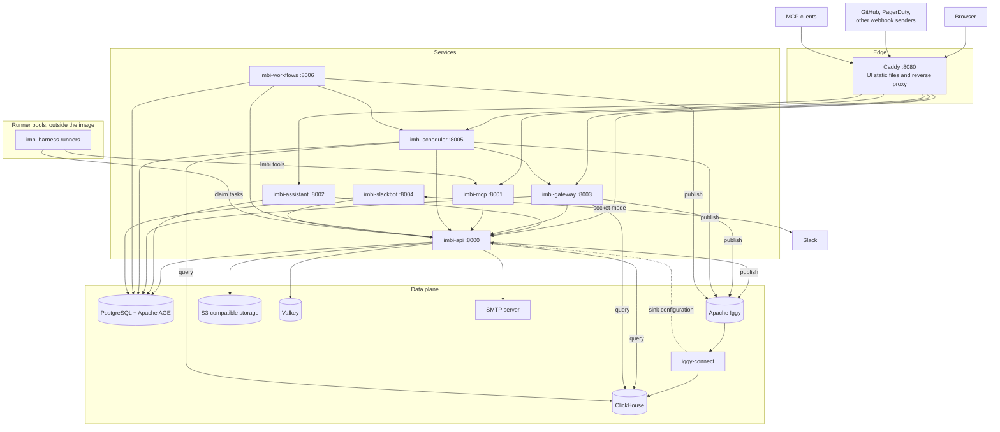

# Architecture Overview

Imbi is a set of Python services, a React UI, and a data plane. The
services and the UI are in one container image
(`ghcr.io/aweber-imbi/imbi`). The agent runner, imbi-harness, has its own
image and runs outside Imbi, in runner pools.

## Platform diagram

The diagram has three zones and the runners:

- **Edge.** Caddy is the only public port. It serves the UI files and sends
  each path prefix to one service. See
  [URL routing](services.md#url-routing).
- **Services.** Each service is a separate process. All of them use the
  `imbi-common` library. imbi-slackbot and imbi-workflows have no public
  route.
- **Data plane.** Postgres holds the catalog. Every ClickHouse write goes
  through Iggy and iggy-connect. See [Events and analytics](events.md).
- **Runner pools.** imbi-harness runners connect out to imbi-api to claim
  agent tasks. imbi-api never connects to a runner. See
  [Agent runtime](agent-runtime.md).

The diagram does not show every call. imbi-api, imbi-assistant,
imbi-slackbot, and imbi-workflows also call the Anthropic API, and the plugins call their remote systems (GitHub,
PagerDuty, SonarQube, AWS, and others).

## Services

| Service | What it does | More |
|---|---|---|
| **imbi-api** | The REST API: the catalog, delivery, documents, scoring, agents, workflows, secrets, authentication, and authorization. It also runs the background workers (see below) | [API](../api/index.md) |
| **imbi-assistant** | The AI assistant in the UI. It streams Claude responses over Server-Sent Events. Its tools are the imbi-api operations (with the user's token), external MCP servers, and UI actions | [Assistant](../assistant/index.md) |
| **imbi-gateway** | Receives webhooks at `/gateway/notifications/{webhook_id}`. It records each delivery, evaluates the webhook rules, and runs the plugin actions that match | [Gateway](../gateway/index.md) |
| **imbi-mcp** | An MCP server. It makes MCP tools from the imbi-api OpenAPI document and sends each call to imbi-api with the token of the caller | [MCP](../mcp/index.md) |
| **imbi-scheduler** | Fires scheduled tasks (cron, interval, one-shot) as one HTTP call to imbi-api or imbi-gateway | [Scheduler](../scheduler/index.md) |
| **imbi-workflows** | The workflow engine. It runs the steps of workflow runs that imbi-api creates, and keeps the scheduler tasks and gateway rules of workflow triggers | [Workflows](../workflows/index.md) |
| **imbi-slackbot** | A Slack bot with the same tools as the assistant. It acts as the Imbi user who wrote the message | [Slackbot](../slackbot/index.md) |
| **imbi-harness** | The agent runner. It is not in the image. One Helm release of `helm/imbi-harness` is one runner pool | [Agent runners](../deployment/agent-runners.md) |

### Background workers in imbi-api

imbi-api runs these workers in its own process. Each one reads a Valkey
stream as part of a consumer group, so the replicas of imbi-api share the
work:

- Score recompute, and a daily scoring tick
- Commit and tag sync, and pull request sync
- Deployment sync, and the release promote watcher
- Maintenance operations
- Identity token refresh
- Document read session sweeper

If imbi-api cannot get a Valkey client at startup, it does not start these
workers. The API itself continues to run.

imbi-api also runs a pool of processes that render prompts, and it sweeps
the expired leases of runners. See [Agent runtime](agent-runtime.md).

### imbi-common

The shared library. All the Python services use it. It contains the
graph client (Postgres and Apache AGE), the ClickHouse query client, the
Iggy publisher, the Valkey client, the domain models, the settings classes,
authentication helpers, the plugin registry and plugin contracts, the
prompt render pool, the LLM helpers, the workflow node registry, the
`/metrics` route, the access log, and Sentry setup. See the
[library reference](../common/index.md).

## Data stores

### PostgreSQL and Apache AGE

PostgreSQL with the Apache AGE extension is the primary data store. The
graph holds the catalog: organizations, teams, users, roles and
permissions, projects and project types, environments, releases,
deployments, blockers, documents, integrations, webhooks and webhook rules,
agents, and prompts.

These services also keep relational schemas in the same database:

| Schema | Owner | Holds |
|---|---|---|
| `agent_runtime` | imbi-api | Agent task state ([ADR 0020](../api/adr/0020-agent-task-contract.md)) |
| `workflows` | imbi-api | Workflow definitions and trigger bindings ([ADR 0021](../api/adr/0021-workflow-contract.md)) |
| `workflow_runtime` | imbi-api | Workflow runs and their steps |
| `secrets` | imbi-api | Secrets broker providers, bindings, and resolutions. No secret material ([ADR 0022](../api/adr/0022-agent-harness-and-secrets-broker.md)) |
| `harness` | imbi-api | Runner pools and dispatch |
| `scheduler` | imbi-scheduler | Task definitions and trigger state. `IMBI_SCHEDULER_SCHEMA` sets the name |

### ClickHouse

The analytics store: the operations log, events, commits, tags, pull
requests, drift verdicts, score history, SBOM components, document
versions and reads, scheduler runs, agent task events and usage, workflow
runs, email audit, maintenance log, and secret audit events. The services
read from it. Only iggy-connect writes to it. See
[Events and analytics](events.md).

### Apache Iggy and iggy-connect

Iggy is a message stream server. Each ClickHouse table has one Iggy
stream. iggy-connect is the Iggy connectors runtime from the same image
(`ghcr.io/aweber-imbi/iggy`, with `IGGY_MODE=connectors`). It drains each
stream into its table. imbi-api, imbi-gateway, and imbi-scheduler do not
start without Iggy.

### S3-compatible storage

Holds uploaded files. imbi-api creates the bucket at startup, and it does
not start if it cannot reach the storage. Caddy sends `/uploads/*` to
imbi-api.

### Valkey

A Redis-compatible store. Only imbi-api uses it: for the work queues of
the background workers, the identity refresh sweeper, and document read
sessions. Set `VALKEY_URL`. The default is `valkey://localhost:6379/0`.

### SMTP

imbi-api sends email (welcome and password reset messages, and workflow
email steps)
through an SMTP server. Email is on by default. For the settings, see
[API configuration](../api/configuration.md).

## Deployment topologies

The `IMBI_SERVICE` variable selects what one container runs:

| Topology | `IMBI_SERVICE` | What runs |
|---|---|---|
| All in one | `all` (default) | Every service and Caddy in one container. imbi-slackbot starts only when `SLACK_APP_TOKEN`, `SLACK_BOT_TOKEN`, and `ANTHROPIC_API_KEY` are set |
| Split | `api`, `assistant`, `gateway`, `mcp`, `scheduler`, `workflows`, or `slackbot` | One service for each container, so that you can scale each one |
| Edge only | `ui` | Caddy only. It serves the UI files and sends each route to the service named in `IMBI_API_UPSTREAM`, `IMBI_ASSISTANT_UPSTREAM`, `IMBI_GATEWAY_UPSTREAM`, `IMBI_MCP_UPSTREAM`, and `IMBI_SCHEDULER_UPSTREAM` (each a `host:port`) |
| Runner pool | none (separate image) | `ghcr.io/aweber-imbi/imbi-harness`, installed with the `helm/imbi-harness` chart, one release for each pool |

A split install uses the `ui` topology as its router. In `all` mode, the
upstreams default to the loopback, so you set none of them.

In `all` mode, the entrypoint makes the service account credentials of
imbi-scheduler, imbi-workflows, and imbi-gateway when you do not supply
them. In a split install, you must supply them. iggy-connect is always a
separate container.

For the Helm chart (`service.mode`) and the variables that each mode
needs, see [Kubernetes](../deployment/kubernetes.md) and
[Docker](../deployment/docker.md).

## Observability

### Prometheus metrics

imbi-api, imbi-gateway, and imbi-scheduler serve `GET /metrics` on the root
of their own port, outside the API prefix. The route has no
authentication. Caddy does not send it to the public:

- `/api/*` keeps its prefix, and the imbi-api `/metrics` is not under it.
- `/gateway/metrics*` and `/scheduler/metrics*` return 404 at Caddy.

Prometheus must scrape the pods directly. The Helm chart adds the
`prometheus.io/*` annotations. In `all` mode a pod can name one scrape
port, so the chart scrapes imbi-api on port 8000 only. iggy-connect serves
its metrics on port 8081, and the chart annotates that Deployment too.

imbi-assistant, imbi-mcp, imbi-workflows, and imbi-slackbot serve no
metrics.

### Sentry

imbi-api, imbi-assistant, imbi-mcp, and imbi-slackbot send errors to Sentry
when `SENTRY_DSN` is set. `SENTRY_TRACES_SAMPLE_RATE` turns on tracing (the
default is `0.0`). In `all` and `ui` modes, the entrypoint uploads the UI
source maps when `SENTRY_AUTH_TOKEN`, `SENTRY_ORG`, and `SENTRY_PROJECT`
are set. Caddy serves the `.map` files only when `SERVE_SOURCE_MAPS` is
`true`.

### OpenTelemetry

imbi-common and imbi-api have an `otel` extra. The `imbi` meta-package
depends on `imbi-common[otel]`, so the container image installs the
OpenTelemetry packages. But no service starts the OpenTelemetry SDK, and
the entrypoint does not run the services under `opentelemetry-instrument`.
If you run a service with OpenTelemetry instrumentation, the access log
adds the trace ID of each request.

### Access logs

imbi-api, imbi-gateway, imbi-scheduler, and imbi-mcp write an access log
line for each request, with the principal when it is known. They do not
log health check and `/metrics` requests.
