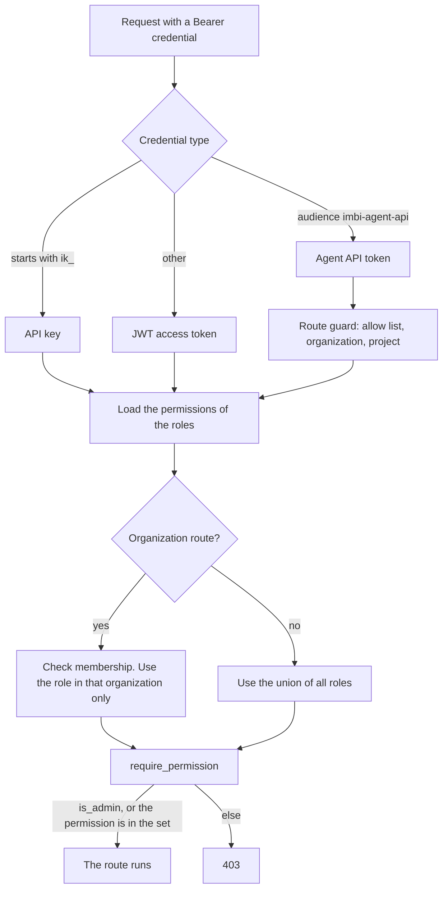

# Security Model

This page tells you who can call Imbi, how imbi-api decides what a caller
can do, which keys protect stored data, and which routes have no
authentication. For the steps to set up sign-in, see
[Authentication](../admin/authentication.md). For roles, see
[Roles and Permissions](../admin/roles-and-permissions.md).

## Principals

A principal is the identity that makes a request. Imbi has two kinds of
stored principal:

- A **user**: a person. A user signs in with a local password or with an
  OAuth login provider.
- A **service account**: a machine identity. Imbi services, runner pools,
  and agents each act as a service account.

Each principal gets roles from its memberships in organizations
(`MEMBER_OF`). Teams do not give roles. A user with `is_admin` set is a
platform administrator and passes every permission check.

A principal sends one of these credentials as `Authorization: Bearer
<credential>`:

| Credential | Format | Principal | Lifetime | Where it works |
|---|---|---|---|---|
| Access token | JWT, `type: access` | User or service account | 1 hour (`IMBI_AUTH_ACCESS_TOKEN_EXPIRE_SECONDS`) | All routes |
| Refresh token | JWT, `type: refresh` | User or service account | 30 days (`IMBI_AUTH_REFRESH_TOKEN_EXPIRE_SECONDS`) | `POST /auth/token/refresh` and the `refresh_token` grant only |
| API key | `ik_<id>_<secret>` | User or service account | Until it expires or you revoke it | All routes |
| Client credential | `client_id` and `client_secret` | Service account | Until it expires or you revoke it | `POST /auth/token` (`client_credentials` grant), which returns an access token |
| Agent API token | JWT, audience `imbi-agent-api` | The service account of an agent | One runner lease (60 seconds). Each heartbeat renews it | The API routes that allow it. See [Agent API tokens](#agent-api-tokens) |
| Agent token | JWT, audience `imbi-harness` | The service account of an agent | 7 days at most. It stops at once when the chain attempt ends | The harness routes only. See [Runner credentials](#runner-credentials) |
| MCP OAuth token | Access and refresh token pair | User | As the access and refresh tokens | All routes, through imbi-mcp |

Imbi stores API keys and client secrets only as Argon2 hashes. You see the
secret one time, when you create it. imbi-api checks the `jti` of an
access token against its `TokenMetadata` node on each request, so a
revoked token stops at once.

`IMBI_AUTH_JWT_SECRET` signs every JWT in this table (HS256). Any process
that has this secret can make a token for any principal. imbi-api,
imbi-assistant, imbi-mcp, imbi-scheduler, and imbi-slackbot verify tokens
with it. imbi-slackbot also uses it to make an access token for the Imbi
user that maps to a Slack user. That token has the claim `channel: slack`.

### Users

A user signs in with one of these:

- A local email and password (`POST /auth/login`), with optional TOTP MFA.
- An OAuth login provider: an integration of the google, github, oidc, or
  aws plugin. The providers are in the database, not in environment
  variables.

Both return an access token and a refresh token. The UI sends the access
token as a Bearer header. It also sets the cookie `imbi_access_token`.
Only the upload routes accept this cookie, because an `` request
cannot send a header.

A user can make API keys. An API key can have scopes. A scope is a
permission name. The key then has only the permissions that are in its
scopes and also in the user's roles.

### Service accounts

A service account authenticates with an API key or a client credential.
See [Service accounts](../admin/service-accounts.md).

`imbi-api setup` makes a service account and a role for each of these
Imbi services:

| Service | Credential | Environment variables |
|---|---|---|
| imbi-scheduler | Client credential | `IMBI_SCHEDULER_SA_CLIENT_ID`, `IMBI_SCHEDULER_SA_CLIENT_SECRET` |
| imbi-gateway | API key | `IMBI_GATEWAY_API_TOKEN` |
| imbi-workflows | Client credential | `IMBI_WORKFLOWS_SA_CLIENT_ID`, `IMBI_WORKFLOWS_SA_CLIENT_SECRET` |

imbi-assistant, imbi-mcp, and imbi-slackbot have no service account. They
send the token of the caller to imbi-api, so imbi-api applies the
permissions of the caller.

Imbi also makes a service account for each agent, and you make one for
each runner pool. A background worker inside imbi-api (for example the
commit sync) uses an internal principal. Imbi does not store this
principal, and no request can set it.

### Agent API tokens

A runner sends the Imbi tool calls of an agent with an agent API token.
imbi-api accepts it as the service account of the agent, with the roles of
that service account. imbi-api also does these checks on each request:

- The route must be on the allow list in
  `apps/api/src/imbi/api/auth/agent_api_routes.py`. A new route is refused
  until a developer classifies it.
- These routes always refuse it: authentication, tokens, API keys, client
  credentials, service accounts, roles, auth providers, identity
  connections, MCP servers, AI providers, secrets, the harness, the Iggy
  connector configuration, and plugin administration. The users and agents
  routes accept it for reads only.
- An `org_slug` in the path, or an `org` query parameter, must be the
  organization of the token.
- A `project_id` in the path must be a project of that organization.

Only the runner holds this token. The model never sees it. See
[Agent Runtime](agent-runtime.md).

### Runner credentials

A runner pool has a service account. The pool credential is a client
credential of that account. A runner uses it to register. Registration
returns two more credentials:

| Credential | Prefix | Used for |
|---|---|---|
| Runner credential | `ihr_` | Heartbeat, claim, and finish |
| Executor credential | `ihe_` | Get and release the secrets of the runner's own claims |

Imbi stores only a SHA-256 hash of each one. They are not JWTs, so all
other routes refuse them.

A claim returns an agent token (audience `imbi-harness`). It authenticates
as the agent's service account, with no permissions. It works only on the
harness routes and the task routes of its chain, and only while the chain
is pinned to the runner in that attempt. When a lease expires, all agent
tokens of that attempt stop at once. See
[Agent Runners](../deployment/agent-runners.md).

### MCP OAuth clients

imbi-api is an OAuth authorization server for MCP clients. imbi-mcp
publishes `/.well-known/oauth-protected-resource`, which points to imbi-api.
imbi-api publishes `/.well-known/oauth-authorization-server`.

An MCP client registers itself with dynamic client registration (DCR,
RFC 7591) at `POST /auth/register`:

- DCR makes public clients only, with the `authorization_code` and
  `refresh_token` grants.
- A redirect URI must use `https`, or `http` on a loopback host.
- PKCE with `S256` is necessary.
- `IMBI_AUTH_DCR_ENABLED=false` turns off registration.

`GET /auth/authorize` sends a user who is not signed in to the Imbi login
page. For a signed-in user, it issues an authorization code. The code store is in Valkey, so
this flow needs Valkey. The client gets a user access token and refresh
token. imbi-mcp
verifies the token, then sends it to imbi-api with each tool call. The
client thus has the permissions of the user.

## Authentication and authorization of a request

Each route that needs a principal uses a FastAPI dependency. The
dependency reads the Bearer credential and makes an `AuthContext`:

The `AuthContext` holds:

| Field | What it holds |
|---|---|
| `user` or `service_account` | The principal |
| `auth_method` | `jwt`, `api_key`, `client_credentials`, or `agent_api` |
| `permissions` | The permission names of the principal's roles, limited by the scopes of an API key or a client-credential token |
| `organization_id` | The organization of an agent API token. Empty for other credentials |
| `session_id` | The `jti` of a JWT, or the id of an API key |

`require_permission` then checks one permission name, for example
`project:write`. A platform administrator passes. `is_admin` applies to
users only, so a service account never passes in this way. Some routes
also accept a `CAN_ACCESS` edge from the user to one resource.

Each process keeps a successful API key check in memory for 60 seconds.
Each request still reads the key from the graph, so a revoked, rotated,
deleted, or expired key stops at once. A change to the roles of the owner
applies within 60 seconds.

### Organization scope

A user can have a different role in each organization. imbi-api uses two
rules:

1. **Organization routes.** These routes are under
   `/organizations/{org_slug}/`: agents, agent tasks, agent usage, the
   agent platform, workflows, workflow runs, secrets, and the deployment,
   commit-sync, and pull-request-sync routes of a project. They check that
   the principal is a member of the organization (`403
   organization_forbidden` if not). There is no administrator bypass for
   membership. Then they use only the role in that organization.
2. **All other routes.** These routes use the union of the roles in all
   organizations of the principal.

The UI applies the same two rules to show or hide buttons. `GET
/users/me` returns the union, and the permissions of the user in each
organization (`organizations[].permissions`).

For the full list of routes and an example, see
[Permissions across organizations](../admin/roles-and-permissions.md#permissions-across-organizations).

A service account that acts with the credential of an integration, for
example to deploy, also needs `integration:act-as-service` and a
membership in the organization of the project (ADR 0017).

### Permission catalog

`imbi-api setup` seeds the permissions and seven built-in roles from
`apps/api/src/imbi/api/auth/seed.py`. After an upgrade, run
`imbi-api setup-permissions` to add new permissions. For the roles and
the full table, see
[Roles and Permissions](../admin/roles-and-permissions.md).

## Encryption keys

Imbi encrypts stored credentials with two Fernet keys. You can rotate
them independently.

| Key | Encrypts |
|---|---|
| `IMBI_AUTH_ENCRYPTION_KEY` | OAuth tokens of identity connections, TOTP secrets, login provider secrets, integration credentials, webhook signing secrets, and the provider lease ids of the secrets broker |
| `IMBI_CONFIG_ENCRYPTION_KEY` | AI provider API keys, and the credentials of the MCP servers that the assistant uses |

`IMBI_AUTH_JWT_SECRET` is not an encryption key, but it is equally
important. It signs every token. The secrets broker also derives its
handle key from it.

!!! warning "Set the keys outside development"
    When `ENVIRONMENT` is not `development`, the auth settings do not load
    unless you set `IMBI_AUTH_JWT_SECRET` and `IMBI_AUTH_ENCRYPTION_KEY`.
    The config key settings do not load unless you set
    `IMBI_CONFIG_ENCRYPTION_KEY`. Imbi loads the config key only when it
    first encrypts or decrypts a value, so a missing config key shows as
    an error at that time, not at startup.

    The default of `ENVIRONMENT` is `development`. In development, each
    process makes random values for the keys that are not set. Then each
    restart makes all tokens invalid and all encrypted values unreadable.
    Only `ENVIRONMENT` starts this check. `IMBI_ENVIRONMENT` does not.

If you lose `IMBI_AUTH_ENCRYPTION_KEY` or `IMBI_CONFIG_ENCRYPTION_KEY`,
you cannot decrypt the values. You must enter the credentials again.

## Secrets broker

The secrets broker gives secrets to agent runners. It does not store
secret material. The material stays in an external system: AWS Secrets
Manager, or a GitHub App that issues a token for each request. imbi-api
stores only providers, bindings, grants, resolutions, and audit events.
See [Secrets](../admin/secrets.md) and
[ADR 0022](../api/adr/0022-agent-harness-and-secrets-broker.md).

The broker has these rules:

- **Deny by default.** A resolution needs exactly one enabled grant that
  allows the whole request. The organization, agent, project, task, and
  runner come from the agent token and the chain, never from the request
  body. Missing context is a denial.
- **Single-use handles.** A resolution returns a handle (`imh_`, 256
  random bits), not the secret. Only the executor credential of the same
  runner can change a handle into material. A handle gives material at
  most `materialization_limit` times. The default is 1. A resolution lives
  one hour at most.
- **HMAC storage.** imbi-api stores a handle only as an HMAC-SHA256. The
  HMAC key comes from `IMBI_AUTH_JWT_SECRET` with its own label. When you
  rotate that secret, all open handles stop.
- **No material in logs.** The material is in memory only, in objects
  that do not print. An audit event holds ids, the purpose, the delivery
  mode, and a result code. It goes to the `secret_audit_events` table in
  ClickHouse, which has no TTL.
- **Release.** Imbi releases the resolutions of a task when the task
  closes, and of a runner when its lease expires. A GitHub App token is
  revoked at GitHub.

## Surfaces with no authentication

| Surface | Service | Protection |
|---|---|---|
| `GET /status` | Each service | Returns service status only |
| `GET /metrics` | imbi-api, imbi-gateway, imbi-scheduler | On the root of each service, for Prometheus to scrape by pod IP. Caddy does not route it: `/gateway/metrics*` and `/scheduler/metrics*` return 404, and the `/metrics` of imbi-api is outside `/api`. Do not expose a service port directly |
| `POST /gateway/notifications/{webhook_id}` | imbi-gateway | The webhook id is a random id of 21 characters. See [Webhook signatures](#webhook-signatures) |
| `/.well-known/oauth-*`, `POST /auth/register` | imbi-api, imbi-mcp | OAuth discovery and DCR. See [MCP OAuth clients](#mcp-oauth-clients) |
| `POST /auth/login`, `POST /auth/token` | imbi-api | Rate limits for each client address |
| `GET /api/iggy/connectors/...` | imbi-api | Needs a key from `IMBI_IGGY_CONNECTORS_API_KEYS`. With no key set, it returns 503 |
| `GET /harness/pools/{name}/queue` | imbi-api | Needs the pool credential as HTTP Basic. The KEDA scaler uses it |

### Webhook signatures

imbi-gateway checks a signature with an HMAC-SHA256 of the raw body and a
constant-time compare. It fails closed:

- **GitHub.** When the webhook has a secret, the `X-Hub-Signature-256`
  header must match. If not, the gateway drops the delivery. The gateway
  processes a delivery to a GitHub webhook with no secret, but marks it
  as not verified.
- **PagerDuty.** When the project's integration edge has a signing
  secret, the `X-PagerDuty-Signature` header must match.

The gateway actions `create_agent_task` and `start_workflow` skip a
delivery that is not verified. A dropped delivery returns `204`, the same
as a delivery with no work. The gateway replaces the signature and
authorization headers with `[redacted]` before it stores a delivery. See
[Webhooks](../admin/webhooks.md).
