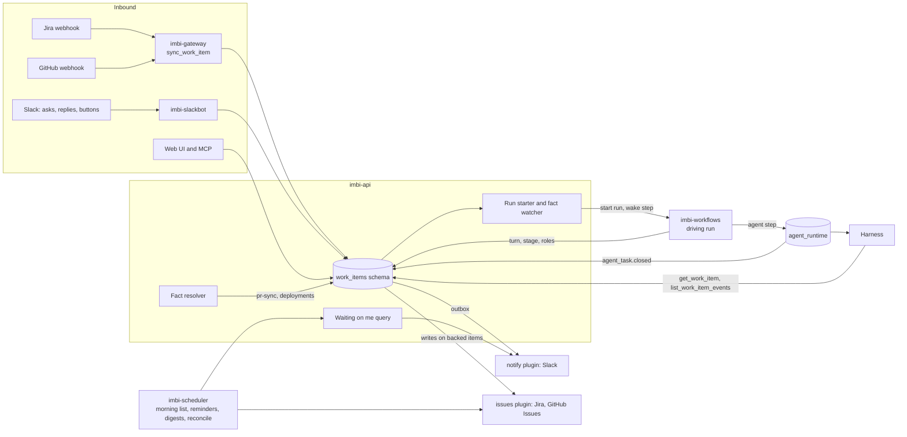
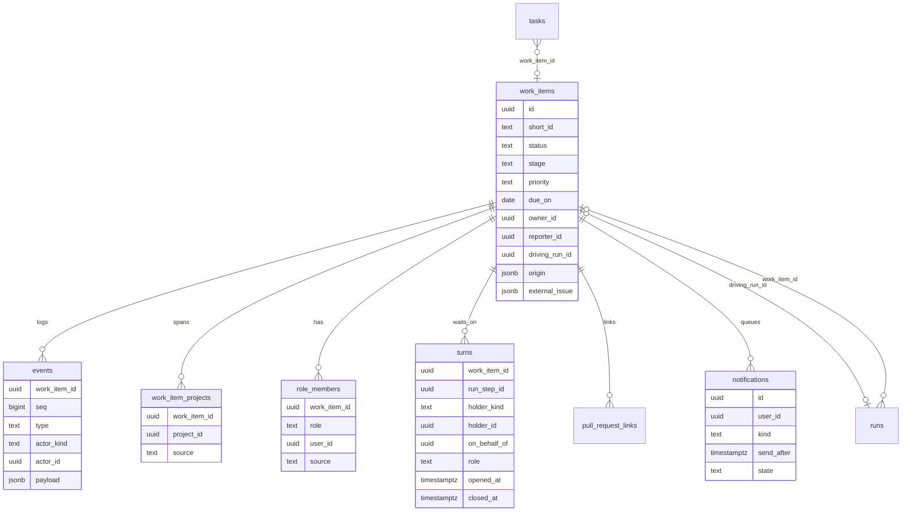
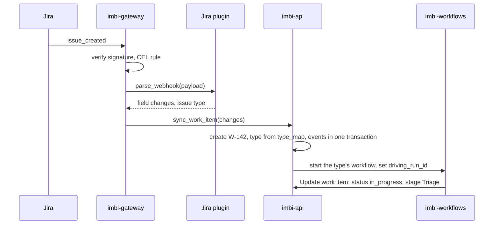
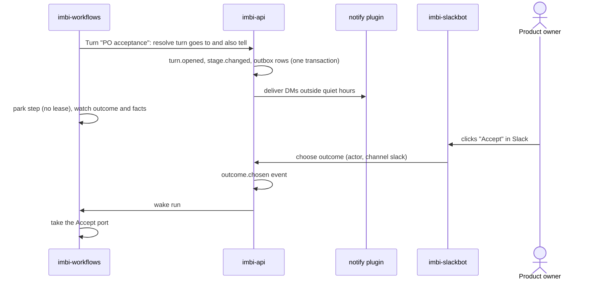
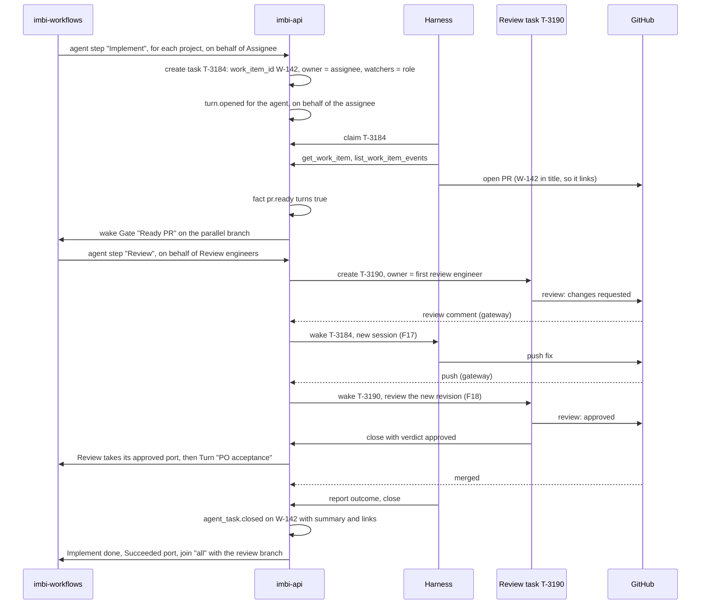
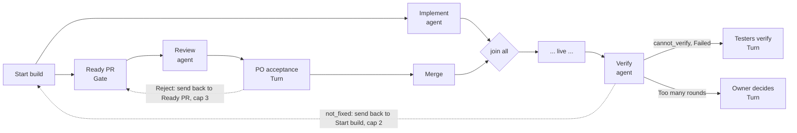
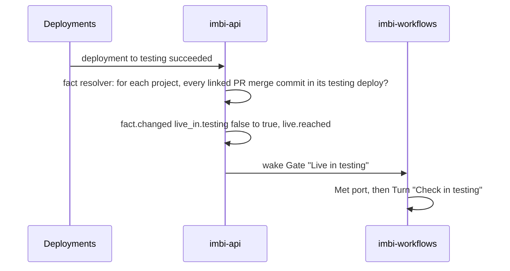
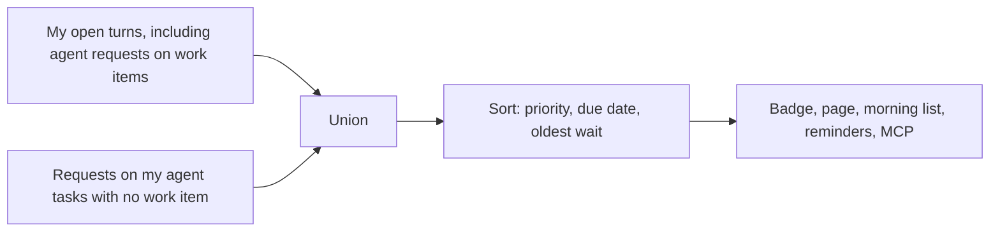

# Work Items

This page shows how a work item moves between people and agents: the
parts, the data, and the flows. For the decisions and the reasons, see
[ADR 0024](../api/adr/0024-work-items.md). For agent tasks, see
[Agent Runtime](agent-runtime.md).

## Parts

| Part | Owns |
|---|---|
| imbi-api | The `work_items` schema, every write, the run starter and fact watcher, the fact resolver, the Waiting on me query, the notification outbox |
| imbi-workflows | Driving runs: Turn, Gate, Branch, Update work item, and agent steps; parking and waking steps; send-back rounds |
| imbi-gateway | Verifies Jira and GitHub webhooks and calls `sync_work_item` |
| imbi-slackbot | Inbound Slack only: new asks, thread replies, button clicks. It calls imbi-api |
| imbi-scheduler | Morning lists, reminders, digests, quiet-hour releases, and the daily reconcile of backed work items |
| `issues` plugins | Jira and GitHub Issues: read, write, transition, comment, parse webhooks, map statuses and role fields |
| `notify` plugin | Slack: DMs and channel posts from the outbox |
| Harness | Runs agent tasks; reads the work item log through the Imbi MCP |

## Data

`runs` is `workflow_runtime.runs` and `tasks` is `agent_runtime.tasks`.
Each gains a nullable `work_item_id`. `role_members` holds only people
set on the work item or mapped from an external field. Other role
resolvers (plugin, work item, pull requests) and facts are
computed when read and are not stored.

## Flow 1: a Jira issue starts a run

Later changes to the issue update W-142 and write events. They wake
steps that wait on them, such as a Gate on the `workerbee-implement-fix`
label. They never start a second run.

## Flow 2: a Turn

A Turn set to give the turn to `everyone` opens one turn per person.
With two PR reviewers and done when `all`, Ana and Raj each get a row in
Waiting on me. The step waits for both, and one `Request changes` wins
over an `Approve`. With `any`, the first outcome closes both turns.

The outcome can also come from a reply. A model reads comments
(`comment.added`, including mirrored Jira and PR comments) and proposes
an outcome; a fact turning true can choose it too. Reminders and "if
nobody acts" are timers on the parked step. The scheduler sends
reminders through the same outbox.

## Flow 3: agents implement and review

Before this, the triage task added the projects with
`add_work_item_project`. Implement runs for each project, so W-142 with
signup-api and email-lib has two implement tasks and two pull requests;
the diagram follows one. Review runs for each pull request.

The run fans out at Start build: one branch is Implement, the other is
the Ready PR Gate, the Review agent step, and the PO acceptance Turn.
The two tasks talk through the pull request, each woken by the other's
comments and pushes ([F17][req-f-tasks], [F18][req-f-tasks]). Rounds
stay inside the tasks, capped by each agent definition. If Implement takes its `Failed`
port, the engine cancels the parked steps on the review branch.

A person steps in when an agent asks. A request the review agent opens
(a question, an approval it cannot judge alone) opens a turn on W-142
for its task owner, the first review engineer, with the request as the
ask. Resolving the request closes that turn.

## Flow 4: a send-back

Two kinds of send-back:

- **Same task.** A PO reject sends back to Ready PR. The reject comment
  on the pull request wakes the open Implement task, which pushes a fix.
  Ready PR, Review, and PO acceptance get round 2 step records. The
  review task for round 2 is new and reads the round 1 review from the
  work item log.
- **New task.** The verify agent's `not_fixed` verdict comes after the
  implement task closed, so it sends back to Start build. Implement runs
  again as a new task, which reads the verify agent's findings from the
  work item log.

When the verify agent cannot decide, it reports `cannot_verify` and the
testers get a Turn.

Earlier rounds stay in the run history. Past the cap, the outcome takes
`Too many rounds`.

## Flow 5: facts and live

The resolver recomputes facts for the work items a change touches: a PR
update recomputes `pr.*` for the work items linked to it, and a deploy
recomputes `live_in.*` for open work items that list that project. A
library has no deploys: a release tag recomputes `released.*` for it
instead.

## Waiting on me

Role members who hold no turn on the item see it under My roles, which
is not counted in the badge.

## Who writes what

| Field | Written by |
|---|---|
| `turns`, `stage`, role members from a step | The driving run only |
| Title, description, status, labels, due, priority, role fields on a backed item | The external system through its plugin; Imbi writes through the plugin first |
| `owner_id` | People with `work_item:write` |
| Handing a turn | People with `work_item:write`; the run keeps waiting for the outcome |
| Task owner | imbi-api, from the agent step's on behalf of role |
| `agent_task.closed` | imbi-api, when a task on the work item closes |
| `fact.changed`, `live.reached` | The fact resolver in imbi-api |

[req-f-tasks]: https://aweber.ghe.com/team-members/gavinr-imbi-dev-env/blob/main/docs/agentic-platform-requirements.md#f-tasks
